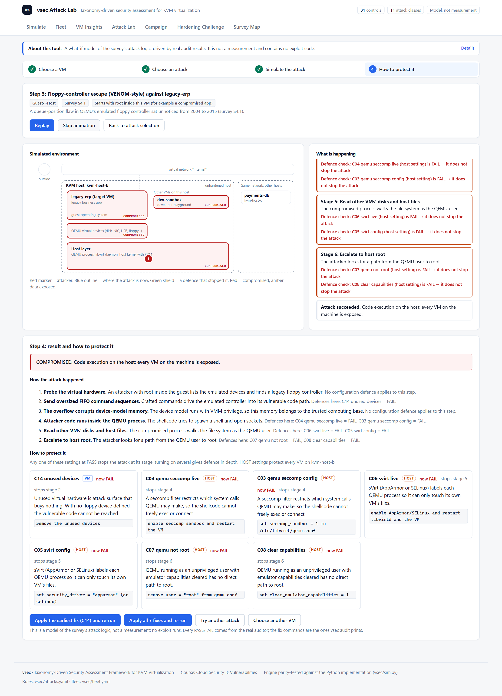
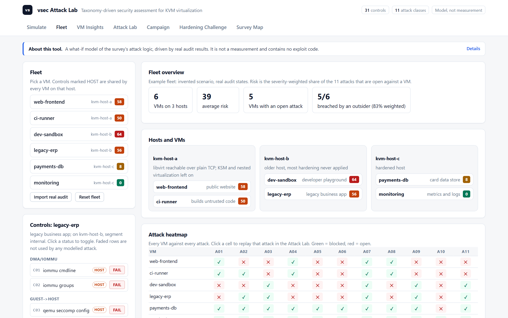
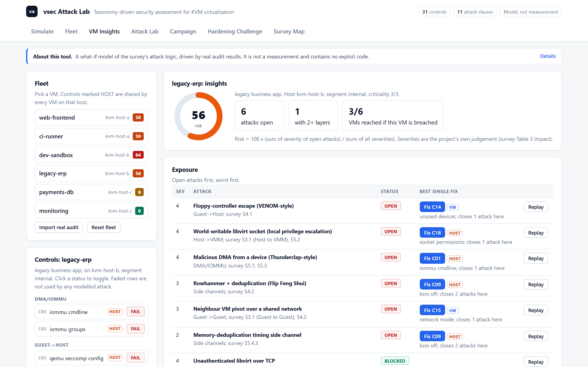
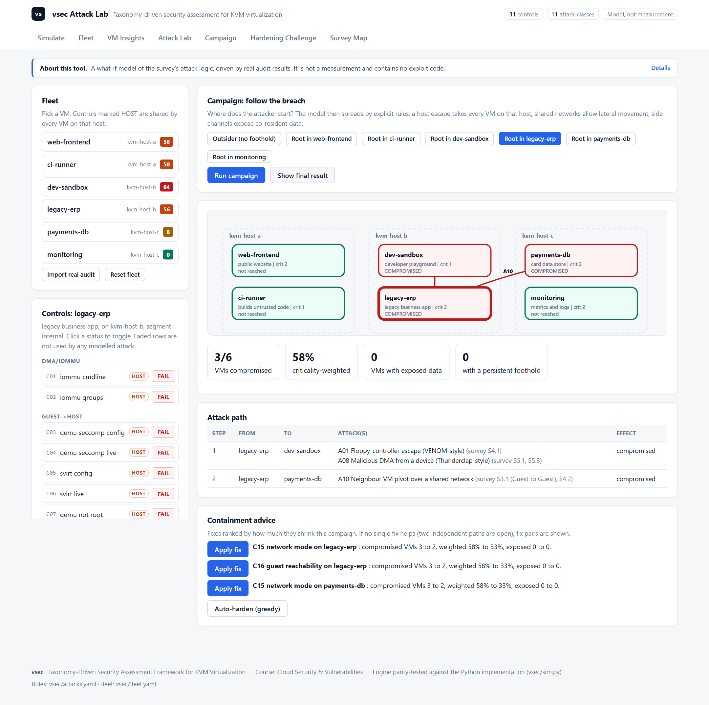
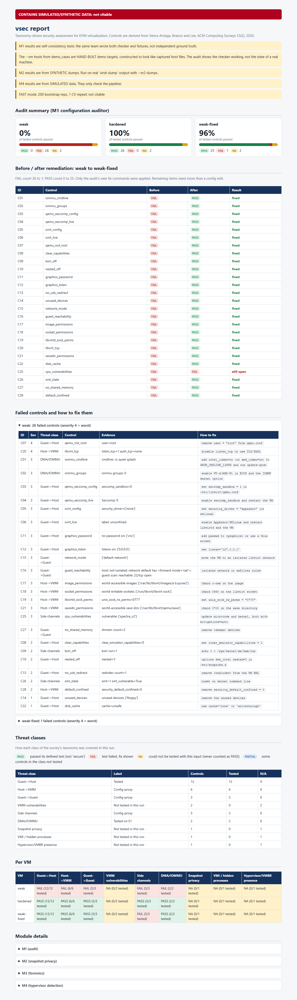
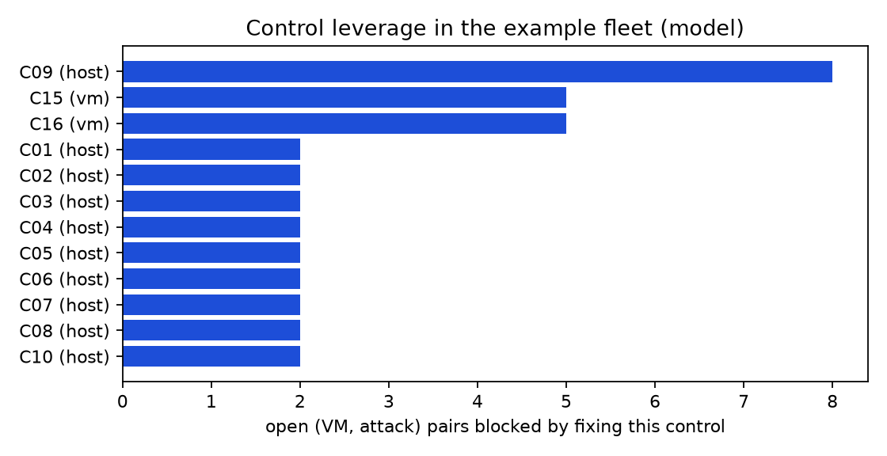
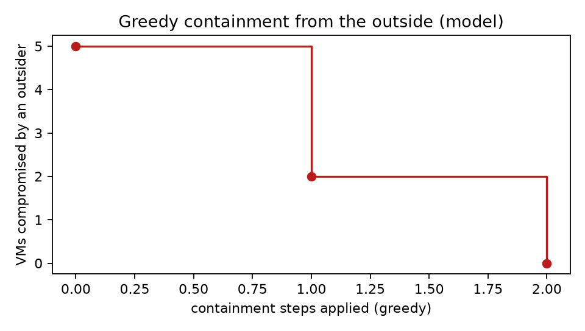
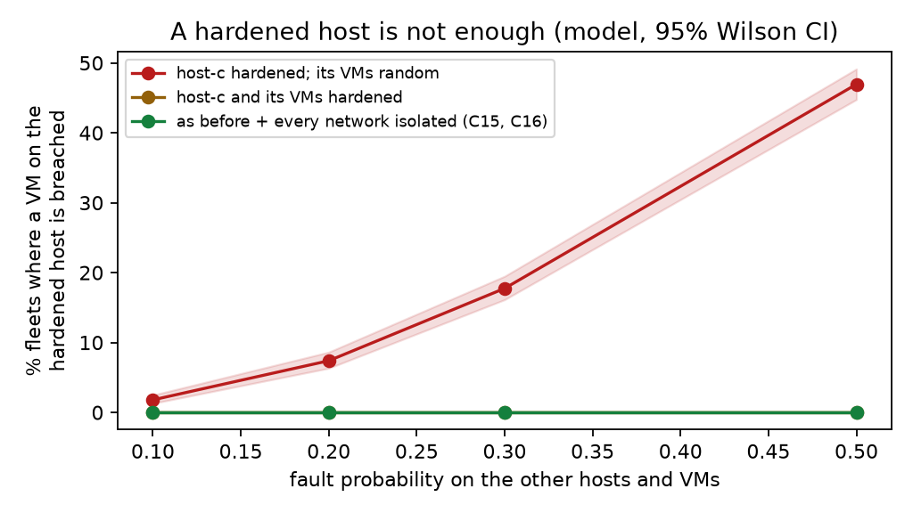

# A Taxonomy-Driven Security Assessment Framework for KVM Virtualization

**Scope and AI assistance.** This project was done by four students using an AI coding assistant (Claude). The assistant produced most of the code, tests, documentation and first drafts of this paper and the slides under the team's direction; the team chose the topic and scope and is responsible for this submission. Code review was done by automated AI reviewers only; no person has independently reviewed or reproduced the work. The tests were written by the same assistant, so they show internal consistency, not correctness. Real measurements exist for one host only (Section 7.8: M1 and M2 on a real KVM host, WSL2 on a laptop). The multi-signal hypervisor-detection experiment (M4) and the forensics module on real dumps (M3) have not been run on real hardware. Results on constructed inputs (Section 7.7) are checks of the tool and the model, not findings about real systems. The analysis plan in prereg.md has not yet been committed and tagged, so it is not yet a pre-registration.

**Status: real measurements from one host (Section 7.8), reproducible experiments on constructed inputs and on the Attack Lab model (Section 7.7).** Sections marked *Not yet measured* wait for real experiments on native hardware and on more hosts. Numbers from constructed inputs or the model are checks of the tool, never findings about real systems.

**Authors:** A. Doni Aditya (23BDS007), B. Harsha Vardan (23BDS015), E. Hariteja (23BDS019), L. Sahith Akash Manikanta (23BDS031)  
**Course:** Cloud Security & Vulnerabilities; submitted to Malay Kumar  
**Date:** November 2026

## Abstract

This paper presents a framework designed to evaluate the 2020 virtualization-security survey's taxonomy on a modern KVM stack. The framework is structured around four modules: (M1) configuration and live security controls auditor; (M2) snapshot privacy and secret leakage analysis; (M3) offline detection of hidden processes in memory forensics; and (M4) multi-signal hypervisor detection against indicator-masked environments. Each module is designed with defined test procedures and ground truth. The centrepiece is a pre-specified analysis plan (M4, recorded in `prereg.md`: DRAFT, not yet committed or tagged) designed to test whether combining behaviour signals would detect a hidden hypervisor faster or more reliably than any single signal alone. Every one of the 31 controls is traced to a section of the survey and of our case study (Section 4.3.1). The framework is implemented in Python and validated by an automated test suite of about one thousand tests on synthetic and simulated data. We also report six reproducible experiments that run without KVM hardware (Section 7.7). Fault injection into 400 constructed configuration folders (10,400 control decisions) shows the auditor reports exactly the seeded faults (precision and recall 100%, 95% CI lower bound 99.9%) in about 40 ms per folder. The snapshot scanner finds every plainly stored planted secret (120/120) with no false positives but none of the base64, UTF-16 or split secrets (0/120). We report this gap and then close most of it: a second scanner version with decoding passes, scored on fresh dumps, finds every UTF-16 and base64 secret (80/120 held-out) with no false positives, while page-split secrets stay undetected. A Monte Carlo study of the Attack Lab model (2,000 random fleets per cell) shows that hardening a host does not protect its VMs: with a 30% fault rate elsewhere, an outsider still reaches a VM on the fully hardened host in 17.8% of fleets, and in 0% once those VMs' own settings are hardened. These are checks of the tool and of the model on known ground truth, not measurements of real hosts. **Real-host results (Section 7.8).** On a real KVM host (WSL2 + KVM on a laptop, QEMU 8.2.2, libvirt 10.0.0), a stock `virt-install` guest fails 8 of 28 configuration controls. After vsec's printed fixes only 2 remain, both platform limits (no IOMMU, no AppArmor in WSL2). Lynis, run on the same host, has no check for these virtualization settings. In a real `virsh dump` snapshot, scanner v2 found all 11 planted secrets (v1: only the 4 plain ones), and redaction removed them. **Not yet measured:** native-hardware experiments (M4), Volatility runs on real dumps (M3) and statistics across many hosts; the M4 analysis plan is not yet committed and tagged. The contribution is the taxonomy-to-test mapping, the working and evaluated implementation, real-host evidence on one platform, and an explicit account of what remains untested.

---

## 1. Introduction

### 1.1 Research Question

Can the threats and controls identified in the 2020 virtualization-security survey be turned into experimentally testable controls on a modern KVM stack? Which of them hold, which fail, and which cannot be tested on this hardware?

### 1.2 Motivation

KVM (Kernel-based Virtual Machine) is the default hypervisor for Linux. As virtualization is ubiquitous in cloud, development, and laboratory environments, the security of the virtualization layer directly impacts the security of workloads running inside VMs. The 2020 survey identified a taxonomy of threats (Guest-to-Host, Host-to-VMM, Guest-to-Guest, VMM vulnerabilities, side channels, DMA/IOMMU concerns, snapshot privacy, hidden-process detection, and hypervisor presence) and controls for each. However, the survey did not establish which of these controls are:

1. **Testable** on commodity hardware with measurable faults,
2. **Effective** against real attacks, or
3. **Practical** for a single security researcher to evaluate.

This work addresses that gap. By implementing a test harness and four evaluation modules, this framework is designed to measure what an attacker could (and could not) discover about a virtualized environment, and what a defender can (and cannot) control. This submission presents the design and implementation, not measured results: the only real run so far is bench.c compiled and executed once in WSL2 (a VM under Hyper-V) on 2026-10-04 as a functional check. Actual measurements depend on hardware (E1) availability.

### 1.3 Contribution

We present:

1. **A framework** that maps the survey's taxonomy onto four modules (M1–M4) and is designed to evaluate each against ground truth on commodity KVM hardware.
2. **M1 (Configuration Auditor):** a tool that checks 28 controls across the taxonomy by reading configuration files and probing live system state. Evaluated by fault injection on constructed folders (Section 7.7, E1 and E2: 78 single-fault and 400 multi-fault cases, no error). This is self-consistency, since the same team wrote checker and fixtures; real-world configurations are still to be tested.
3. **M2 (Snapshot Privacy):** a secret scanner and redactor for memory snapshots. On synthetic dumps with planted ground truth (E3) it finds every plainly stored secret with zero false positives and misses every encoded one; real dumps are pending.
4. **M3 (Memory Forensics):** offline detection design for hidden processes and modules using Volatility 3 on public memory images. Analysis pending.
5. **M4 (Multi-Signal Hypervisor Detection):** a pre-specified analysis plan (recorded in `prereg.md`: DRAFT, not yet committed or tagged) designed to test whether combining behaviour signals (timing, memory latency, scheduler jitter, performance counters) detects a hidden hypervisor faster than any single signal, under controlled conditions on E1 (a native machine). Data collection pending.

6. **The Attack Lab (Section 4.7):** an interactive fleet simulator. A user inspects hosts and VMs, launches one of 11 attacks from the survey, follows a breach from VM to VM, and gets a ranked fix plan and runbook. Every control state comes from the real auditor, and the page can import a real audit. It is a model of the survey's logic, not a measurement.
7. **An evaluation that runs today (Section 7.7):** six reproducible experiments (`python scripts/run_experiments.py`, fixed seed) covering auditor accuracy under fault injection, auditor cost, scanner recall and redaction, and three model studies: which controls give the most protection, how fast containment works, and whether a hardened host is enough.

A design observation is that **not all threats can be tested on all hardware.** Some controls are marked **Config-proxy** (configuration or version check only), others **N/A** on E0 (WSL2), and some require native hardware (E1). We report honestly what each label means.

### 1.4 Claims and Disclaimers

**PASS means "this control passed its test."** It does NOT mean "the system is secure." A single test failing does not prove an attack is possible in a given threat model.

Specific claims we do NOT make:

- **M4** detects the presence of a hypervisor that fakes time (TSC offsetting, VM-exit latency masking). That is out of scope and listed as future work.
- **M4** is tested on one CPU model on one machine. Results may not generalise to other hardware.
- **M3** proves that no hidden process exists. It detects unlinked (hidden) processes and modules only when a dump is taken. An attacker acting between dumps is undetected.
- **M1 synthetic fixtures** are self-consistency tests: written by the same team as the checker. Independent correctness evidence comes from live Lynis/OpenSCAP comparison and real-world configurations.
- Anything this hardware cannot test is marked **N/A**, never passed.

### 1.5 Team and AI Assistance

This is a university project conducted by four students with Claude assistance. It builds on the team's case study of the 2020 survey. Claude produced most of the code, tests, documentation and first drafts of this paper under the team's direction. The team chose the topic and scope, and is responsible for this submission. Code review was done by automated AI reviewers only; no person has independently reviewed or reproduced the work. The tests were written by the same assistant, so they show internal consistency, not correctness. Numbers from constructed inputs or the model (Section 7.7) check the tool and are not findings about real systems; Section 7.8 reports real measurements from one host.

---

## 2. Literature Review

### 2.1 Threat Classes and the 2020 Survey

The 2020 virtualization-security survey (referenced as [SURVEY-2020] below) identified a taxonomy of threats to virtualized systems. This chapter outlines that taxonomy and cites its key threat classes.

#### 2.1.1 Guest-to-Host Attacks

**Threat:** A compromised or malicious guest VM escapes to the hypervisor host, gaining code execution or information disclosure on the host.

**Key controls:**
- QEMU sandbox (seccomp) restricts QEMU process system calls. [LIBVIRT-QEMU; EDGE-2015]
- SELinux or AppArmor (sVirt) confines the QEMU process with a per-VM security label. [LIBVIRT-QEMU]
- Unprivileged QEMU: the QEMU process runs as an unprivileged user, not root. [LIBVIRT-QEMU]
- Clear emulator capabilities: the process starts without unnecessary Linux capabilities. [LIBVIRT-QEMU]
- Nested virtualization off: disables VM-in-VM, which can aid escape attacks. [KERNEL-NESTED]
- Remove unused devices: QEMU emulates many devices; unused ones (sound, parallel, USB redirect, floppy) are attack surface. [SURVEY-2020, Sec. 4.1]
- Graphics (VNC/SPICE) password and localhost-only: prevents unauthenticated console access. [LIBVIRT-DOM]
- Disk cache mode not unsafe: cache='unsafe' can corrupt data and aid exploits; use 'none' or 'writethrough'. [LIBVIRT-DOM]

**Test type:** Config + live checks. Configuration files are read; live checks probe /proc and /sys to confirm settings are active.

**Label in result matrix:** **Tested**

#### 2.1.2 Host-to-VMM and VMM Vulnerabilities

**Threat:** An unprivileged process on the host, or a configuration weakness, allows privilege escalation or VM escape.

**Key controls:**
- Disk image permissions: files are not readable/writable by other users (mode o-rwx). [LIBVIRT-QEMU]
- libvirt socket permissions: the libvirt daemon socket has restricted permissions (0660, not 0666). [LIBVIRT-DAEMONS]
- No TCP libvirt: listen_tcp is off or requires TLS/SASL authentication, not cleartext. [LIBVIRT-AUTH]
- CVE verification: QEMU and kernel versions are not known-vulnerable. [NVD]

**Test type:** Config + version checks.

**Label in result matrix:** **Config-proxy** (configuration or version is checked; no active attack is run)

#### 2.1.3 Guest-to-Guest Attacks

**Threat:** VM A gains network or memory access to VM B.

**Key controls:**
- Network isolation: guests on different libvirt networks or with nwfilter rules are not reachable from each other. [LIBVIRT-NET]
- No shared memory: no <shmem> devices between VMs. [LIBVIRT-DOM]

**Test type:** Config + live reachability scan.

**Label in result matrix:** **Tested**

#### 2.1.4 Side Channels

**Threat:** Timing differences, cache contention, or SMT-related leakage reveals secrets from one VM to another on the same host.

**Key controls:**
- KSM (Kernel Samepage Merging) off: KSM deduplicates identical pages, which can leak information across VM boundaries. [KERNEL-KSM; SUZAKI-2011; RAZAVI-2016]
- CPU vulnerability mitigations: processor errata (e.g., Spectre, Meltdown) have mitigations that must be enabled. [KERNEL-HWVULN; KOCHER-2019; VANBULCK-2018]
- SMT state: simultaneous multithreading can amplify side channels; may need disabling. [KERNEL-HWVULN]

**Test type:** Config + live checks (/sys/kernel/mm/ksm/run, /sys/devices/system/cpu/vulnerabilities/*)

**Label in result matrix:** **Config-proxy**

#### 2.1.5 DMA and IOMMU

**Threat:** A guest with a passed-through device (e.g., NIC) can perform DMA to arbitrary host memory, or a device can be exploited to attack the host.

**Key controls:**
- IOMMU enabled: Intel VT-d or AMD-Vi creates a hardware isolation boundary for DMA. [KERNEL-IOMMU; MARKETTOS-2019]
- IOMMU groups: devices are grouped such that one cannot DMA outside its group without permission. [KERNEL-VFIO]

**Test type:** Kernel command-line check and /sys/kernel/iommu_groups inspection (E1 only; N/A on E0/WSL2).

**Label in result matrix:** **Tested on E1** (N/A on E0)

#### 2.1.6 Snapshot Privacy

**Threat:** A saved VM snapshot (memory image) contains secrets (SSH keys, API tokens, passwords) that can be extracted offline.

**Key controls:**
- Redact or encrypt snapshots before storage or sharing. [SURVEY-2020, Sec. 6.1.1]; evaluated by module M2 of this work
- Avoid storing long-lived secrets in guest memory; use secret-injection or external stores. [SURVEY-2020, Sec. 6.1.1]

**Test type:** Memory dump analysis with pattern matching and entropy filtering; ground truth verification by exact byte search.

**Label in result matrix:** **Tested**

#### 2.1.7 Hidden Processes and Memory Forensics

**Threat:** A rootkit or attacker hides a process or kernel module by unlinking it from kernel data structures, so that standard tools (ps, lsmod) do not see it.

**Key controls:**
- Periodic memory forensics: offline memory dumps are analysed with tools like Volatility to detect unlinked processes. [VOLATILITY; GRAZIANO-2013; ACTAEON]

**Test type:** Live memory dump followed by offline analysis (pslist vs psscan, lsmod vs module scan).

**Label in result matrix:** **Tested**

#### 2.1.8 Hypervisor/VMBR Detection

**Threat:** An attacker wants to know whether they are running in a VM, and if so, what kind.

**Attack/Detection signals:**
- Static indicators: CPUID leaf 0x1 (hypervisor present bit), DMI strings (manufacturer, product name), device models (e.g., "virtio", "QEMU"). [SURVEY-2020, Sec. 7.2.1]
- Dynamic/behaviour signals: timing side channels (CPUID latency, RDTSC, syscall/page-fault cost); memory latency (sequential, random, TLB miss proxies); scheduler jitter. [GARFINKEL-2007; HUND-2011; RAFFETSEDER-2007; SURVEY-2020, Sec. 7.2.1]

**Threat model:** A non-adaptive hypervisor that hides static indicators (via libvirt options like <features><kvm><hidden/></features>) but does not fake time.

**Test type:** Multi-signal classification on behaviour features, pre-specified hypothesis test (H1–H4, recorded in DRAFT `prereg.md`).

**Label in result matrix:** **Tested**

### 2.2 Scope of This Work

This framework evaluates all NINE threat classes on modern KVM. We test:

- **Guest-to-Host:** 12 controls
- **Host-to-VMM:** 6 controls
- **Guest-to-Guest:** 3 controls
- **VMM vulnerabilities:** 2 controls
- **Side channels:** 3 controls
- **DMA/IOMMU:** 2 controls
- **Snapshot privacy:** 1 control (M2)
- **VMI / hidden processes:** 1 control (M3)
- **Hypervisor/VMBR presence:** 1 control (M4)

**Total: 31 controls** (M1 auditor: 28 controls; M2, M3, M4 each add 1 centrepiece control).

The nine threat classes and 31 controls in this taxonomy are this project's own mapping, drafted with an AI assistant from libvirt, QEMU and kernel documentation, and traced to the survey's sections in Section 4.3.1.

---

## 3. Research Gap

### 3.1 Why This Work Matters

The 2020 survey identified threats and controls but did not measure them. Open questions remain:

1. **Can these controls be tested on commodity hardware?** Not all threat models are practical to evaluate. For instance, DMA attacks require a physical device and careful setup; on WSL2, IOMMU groups do not exist.

2. **Are the controls effective?** A configuration setting can be checked, but does it actually prevent an attack?

3. **What is the cost of enforcement?** Some defences (like seccomp, sVirt confinement) add overhead.

4. **Which controls matter most?** With 31 controls and multiple threat classes, priorities are unclear.

5. **Can a hidden hypervisor be reliably detected?** Prior work on hypervisor detection focused on static indicators. If an attacker hides those (CPUID masking, DMI spoofing, device model renaming), can behaviour signals still detect the VM? And can combining multiple signals improve detection speed or reliability?

### 3.1.1 What Is New Compared with Existing Practice

Existing hardening tools (Lynis, OpenSCAP with SCAP Security Guide profiles, CIS-style benchmarks) answer "which settings are wrong?". They report a flat list in which every finding looks equally important, and none of them is organised by a research taxonomy of virtualization attacks. Surveys such as Sierra-Arriaga et al. describe attacks and defences in prose that cannot be executed against a system. This work joins the two.

| Capability | Hardening checklists (Lynis, OpenSCAP, CIS) | Virtualization survey (prose) | vsec (this work) |
|---|---|---|---|
| Checks real host and VM configuration | Yes | No | Yes (M1, 28 controls) |
| Every check traced to a survey threat class and section | No | n/a | Yes (Section 4.3.1) |
| Attacks modelled as stages, each stopped by named controls | No | Described, not executable | Yes (11 attack chains) |
| Spread across VMs and hosts (host escape, lateral movement, side-channel exposure) | No | Described | Yes (campaign model) |
| Fixes ranked by how many attacks they stop; exact smallest fix set | No | No | Yes |
| Defence in depth per attack (how many controls hold) | No | No | Yes |
| States NA instead of guessing PASS when a check cannot run | Partly | n/a | Always |
| Pre-specified analysis plan for the detection experiment | n/a | n/a | Yes (M4, `prereg.md`, draft) |

The comparison is of capabilities as we understand these tools' documented purpose, not a benchmark. The new part is not any single check, most of which are standard hardening advice, but the **attack-chain layer on top of real audit results**. It turns a list of findings into answers to three questions a checklist cannot answer: which attack does this misconfiguration enable, how far does the breach spread, and which fix should come first. Section 7.7 shows two findings that a flat checklist cannot express: one control (C09) stops more modelled attacks than any other, and a fully hardened host does not protect a VM whose own network settings are weak.

### 3.2 Scope and Disclaimers

This work is **not**:

- A penetration test or actual attack (we do not exploit vulnerabilities; we test mitigations).
- A proof of correctness (PASS means "this control passed its test", not "the system is secure").
- A proof of generality (results are for one CPU model on one machine).
- A time-faking or adaptive hypervisor detection (out of scope).

This work **is**:

- A measurement framework that honestly reports what can and cannot be tested.
- A benchmark for evaluating hypervisor hardening configurations.
- A case study in translating a threat taxonomy into testable, measurable security properties.

---

## 4. Framework

### 4.1 Overall Design

The framework consists of:

1. **Taxonomy (`taxonomy.yaml`):** 31 controls, each with an ID, threat class, module, test type (config/live/version), severity, expected outcome, test logic, and fix command.

2. **Common finding format:** Every module produces findings in the same JSON schema:
   ```json
   {
     "id": "C07",
     "module": "M1",
     "taxonomy": "Guest->Host",
     "control": "qemu_not_root",
     "status": "PASS|FAIL|NA",
     "severity": 4,
     "evidence": "...",
     "fix": "...",
     "env": "E0|E1",
     "vm": "weak|hardened|target|kvm-plain|kvm-masked"
   }
   ```

3. **Four modules:**
   - **M1 (Configuration Auditor):** Audits 28 controls (Guest-to-Host, Host-to-VMM, Guest-to-Guest, VMM vulnerabilities, side channels, DMA/IOMMU, and helpers). Reads files and probes live state.
   - **M2 (Snapshot Privacy):** Scans memory dumps for leaked secrets using pattern matching and entropy. Evaluates redaction.
   - **M3 (Memory Forensics):** Runs Volatility 3 on memory dumps; compares pslist vs psscan and lsmod vs module scan. Detects hidden processes and modules.
   - **M4 (Multi-Signal Detection):** Runs a pre-specified analysis plan on native vs masked VMs, combining behaviour signals to detect virtualization (DRAFT `prereg.md`, not yet committed).

4. **Result matrix:** Per threat class, reports:
   - Label: "Tested", "Config-proxy", or "N/A" (test not possible on this hardware).
   - Number of controls and number tested.
   - Per VM: PASS/FAIL/PARTIAL/NA.

5. **One command:** `python -m vsec run` reads all inputs and produces a JSON report and HTML summary.

### 4.2 Finding Status Definitions

- **PASS:** The control passed the test. The system is not vulnerable to this specific check.
- **FAIL:** The control failed. The check detected a configuration or runtime condition that should be fixed.
- **NA (Not Applicable):** The test could not run (hardware doesn't support it, data missing, tool not available).
- **ERROR:** The module crashed. A serious problem; the report shows a red banner.

For the result matrix:

- **Tested:** Threat class has at least one control that was tested (not all N/A).
- **Config-proxy:** Only configuration or version checks; no active attack or live measurement.
- **N/A:** No test was possible on this hardware.

For per-VM status:

- **PASS:** Every control in the threat class was tested AND passed.
- **FAIL:** At least one control failed.
- **PARTIAL:** Some controls tested, some N/A.
- **NA:** No controls were tested.

### 4.3 Threat Classes and How Each is Tested

| Threat class | Test method | Label |
|---|---|---|
| Guest→Host | M1 config + live checks (seccomp, sVirt, devices, permissions) | Tested |
| Host→VMM | M1: libvirt and QEMU config, socket/image permissions | Config-proxy |
| Guest→Guest | Host-side network-definition check (isolated, no forward/ip) plus config checks; a guest reachability scan can only add a FAIL | Config-proxy |
| VMM vulnerabilities | QEMU and kernel version vs CVE list | Config-proxy |
| Side channels | `/sys/kernel/mm/ksm/run`, SMT state, CPU vulnerabilities | Config-proxy |
| DMA/IOMMU | IOMMU kernel cmdline, `/sys/kernel/iommu_groups` (E1 only) | Tested on E1; N/A on E0 |
| Snapshot privacy | M2 memory scan for secrets, redaction test | Tested |
| VMI / hidden processes | M3 Volatility pslist vs psscan, lsmod vs module scan | Tested |
| Hypervisor/VMBR presence | M4 multi-signal classification (behaviour + optional static indicators) | Tested |

### 4.3.1 Traceability: Survey Section to Control

Each control is traced to the section of the survey [SURVEY-2020] it derives from (S = survey section) and to the table of our case study report (CS) that summarises it. T9 is the case study's control checklist. This mapping is the project's own judgement; the survey does not define these controls. C22 has no direct survey basis and is a project addition.

| ID | Control | Threat class | Survey basis |
|---|---|---|---|
| C01 | iommu_cmdline | DMA/IOMMU | S5.1, S5.3 (IOMMU needs OS/firmware config, Thunderclap); CS T4, T9-DMA |
| C02 | iommu_groups | DMA/IOMMU | S5.1, S5.3; CS T4, T9-DMA |
| C03 | qemu_seccomp_config | Guest->Host | S4.1 (device model runs with VMM privilege), S5.2 (VMM attack surface); CS T3, T9-escape |
| C04 | qemu_seccomp_live | Guest->Host | S4.1, S5.2; CS T3, T9-escape |
| C05 | svirt_config | Guest->Host | S4.1, S6.8 (privilege separation); CS T9-escape |
| C06 | svirt_live | Guest->Host | S4.1, S6.8; CS T9-escape |
| C07 | qemu_not_root | Guest->Host | S4.1, S6.8; CS T9-escape |
| C08 | clear_capabilities | Guest->Host | S4.1, S6.8; CS T9-escape |
| C09 | ksm_off | Side channels | S4.2 (rowhammer + dedup), S5.4.3 (dedup timing); CS T3, T5, T9-sidechannel |
| C10 | nested_off | Guest->Host | S2 (nested virtualization), S7.1.2 (Blue Pill uses HW virtualization) |
| C11 | graphics_password | Guest->Host | S2.1 (VMM administration function), S5.2 (management software as vector) |
| C12 | graphics_listen | Guest->Host | S2.1, S5.2 |
| C13 | no_usb_redirect | Guest->Host | S2.1 (device emulation), S4.1; CS 5.1 |
| C14 | unused_devices | Guest->Host | S4.1 (VENOM floppy, NE2000, Cirrus VGA); CS T3, 5.1, T9-escape |
| C15 | network_mode | Guest->Guest | S3.1 (Guest to Guest), S4.2 |
| C16 | guest_reachability | Guest->Guest | S3.1 (Guest to Guest), S4.2 |
| C17 | image_permissions | Host->VMM | S3.1 (Host to VMM), S6.1.1 (snapshot/image data exposure); CS T9-data |
| C18 | socket_permissions | Host->VMM | S3.1 (Host to VMM), S5.2 (VM management software) |
| C19 | libvirtd_sock_perms | Host->VMM | S3.1 (Host to VMM), S5.2 |
| C20 | libvirt_tcp | Host->VMM | S3.1 (Host to VMM), S5.2 |
| C21 | savedir_permissions | Host->VMM | S6.1.1 (PPVM: snapshots leak secrets), S6.3.3; CS T9-data |
| C22 | disk_cache | Guest->Host | none direct (project addition: guest data integrity hygiene) |
| C23 | qemu_cve | VMM vulnerabilities | S4.1, S5.2; CS T3 |
| C24 | kernel_cve | VMM vulnerabilities | S2 (KVM is a kernel module), S4.1, S5.2 |
| C25 | cpu_vulnerabilities | Side channels | S5.4.5 (Spectre, L1TF/Foreshadow); CS T5, T6, T9-sidechannel |
| C26 | smt_state | Side channels | S5.4.1, S5.4.5; CS T6, T9-sidechannel |
| C27 | no_shared_memory | Guest->Guest | S3.1 (Guest to Guest), S4.2 |
| C28 | default_confined | Host->VMM | S6.8 (privilege separation) |
| C29 | snapshot_secrets | Snapshot privacy | S6.1.1 (PPVM), S6.3.3 (VM snapshots); CS T7, T9-data |
| C30 | hidden_process | VMI / hidden processes | S6.5.1 (VMI), S7.2.1 (memory-dump analysis, Actaeon); CS T7, T8 |
| C31 | hypervisor_presence | Hypervisor/VMBR presence | S7.1, S7.2.1, S7.2.2; CS T8, 8.4 |

**Coverage of the case-study checklist (T9).** Controls exist for device-emulation escape, DMA/IOMMU configuration, side-channel mitigation settings, snapshot data exposure and rogue-hypervisor presence. Not yet covered: PCIe ACS, DMA-remap register locking, device-memory scrubbing on reassignment, Secure Boot or measured launch against a VMBR, memory encryption (SEV/TDX), cache partitioning, guest kernel-integrity monitoring, and a written threat model per deployment. These are reported as not covered, not as passed.

### 4.4 Environments

| Env | What | Used by |
|---|---|---|
| **E0** | Laptop: WSL2 Ubuntu 24.04 + KVM/libvirt (nested VM under Hyper-V); used for the real-host results in Section 7.8 | M1, M2, M3 |
| **E1** | External SSD, native Ubuntu 24.04 (Hyper-V not loaded) | M4, M1 live checks (sVirt, IOMMU) |

**Why two?** The laptop runs Hyper-V, so it has no bare-metal option. E1 is the "true" native environment for M4's primary comparison (native vs kvm-masked).

### 4.5 VMs Used

- **weak, hardened:** Pre-hardened configurations for M1 testing and Lynis/OpenSCAP comparison.
- **target:** Isolated VM for M2 planting and M3 dumps. No network; reverted to a snapshot before each experiment.
- **kvm-plain, kvm-masked:** For M4. Both run on E1. `kvm-masked` hides static CPUID and DMI indicators using standard libvirt options (<features><kvm><hidden/></features>, host-passthrough CPU mode, <sysinfo> spoofing).

### 4.6 The Four Modules

#### 4.6.1 M1: Configuration Auditor

**Purpose:** Check 28 security controls across the taxonomy.

**Controls:**
- IOMMU (C01, C02)
- QEMU seccomp (C03, C04)
- SELinux/AppArmor (C05, C06)
- QEMU not root (C07)
- Clear capabilities (C08)
- KSM, nested virt, USB redirect, unused devices (C09–C14)
- Network isolation (C15, C16)
- Image/socket permissions (C17, C18, C19)
- libvirt TCP (C20)
- Saved-state permissions (C21)
- Disk cache (C22)
- CVE version checks (C23, C24)
- CPU vulnerabilities, SMT (C25, C26)
- Shared memory (C27)
- Default confinement (C28)

**Ground truth:**
- **Synthetic:** 50 test cases with ≥3 seeded faults per control. Fixture folders contain VM XML and captured /proc, /sys, /etc/libvirt files.
- **Real-world:** ~10 real configurations (Ubuntu default libvirt, Proxmox, OpenStack).

**Evaluation:**
- Unit: (test case, control) pair.
- Metrics: Precision, recall, F1, FPR per control, with Wilson 95% CIs.
- Tool comparison: Live audit of `weak` and `hardened` hosts vs Lynis and OpenSCAP.

**Output:**
- Per-control PASS/FAIL/NA with evidence.
- Illustrative attack paths (documented as examples, not claims of accuracy).
- JSON findings for the main report.

#### 4.6.2 M2: Snapshot Privacy

**Purpose:** Measure secret leakage from memory snapshots.

**Secret types:** SSH keys, AWS credentials (key ID and secret), JWT tokens, 32-byte hex keys.

**Secret states:** Live (in a running process), freed (deallocated but not overwritten), exited (process has exited and memory not reused).

**Cells:** 4 types × 3 states = 12 cells; n=5 first, then 10 per cell.

**Variants (held-out):**
- Split across page boundaries.
- UTF-16 encoded.
- Base64 encoded.

**Real programs:** `ssh-agent` holding a key, `openssl s_server` with a certificate.

**Scanner:** Pattern matching (SSH PEM blocks, AWS AKIA ID, AWS secret, JWT) + entropy filter (reject low-entropy matches like "0000...").

**Evaluation:**
- Recall per cell, variant, and real program (fraction found).
- False positives per GB scanned.
- Redaction: redact secrets in virsh save image, restore VM, confirm it resumes and service still runs.

**Ground truth:** Exact byte search for planted needles. A secret counts as "present" only if all needles are found.

**Output:** Recall, false-positive rate with Wilson CIs; redaction success/failure per secret type.

#### 4.6.3 M3: Memory Forensics

**Purpose:** Detect hidden (unlinked) processes and kernel modules in offline memory dumps.

**Method:** Run Volatility 3 plugins (pslist, psscan, lsmod, hidden_modules) and compare results.

**Ground truth:**
- **Main:** Public Linux memory forensic images (Volatility corpus, academic course datasets) with documented hidden processes.
- **Optional:** Public rootkit (Diamorphine or similar) on `target` VM in three kernel versions.

**Evaluation:**
- Exact counts (e.g., 7/8 detected) with Clopper-Pearson 95% CIs.
- Failure cases: processes that escaped detection, broken on specific kernels.
- Scan time; false positives under process churn (processes starting/exiting at dump time).

**Output:** Detected/total counts per process and kernel version; failure table.

#### 4.6.4 M4: Multi-Signal Hypervisor Detection

**Purpose:** Test whether combining behaviour signals detects a hidden hypervisor faster and more reliably than any single signal.

**Threat model:** Non-adaptive hypervisor that hides static indicators (CPUID, DMI) but does not fake time. One CPU model, one machine.

**Classes:** native (boot from external SSD), kvm-plain (QEMU/libvirt, standard config), kvm-masked (QEMU/libvirt with CPUID/DMI masking).

**Signals (behaviour only, not static indicators):**
- Timing: CPUID latency, RDTSC speed, syscall latency, page-fault latency.
- Memory: sequential memory latency, random memory latency, TLB-miss proxy (page-stride latency ratio).
- Performance counters: Linux `perf` (if exposed by the hardware).
- Scheduler noise: jitter on a fixed-sleep loop.

**Workloads:** idle, cpu-bound, memory-bound, mixed.

**Design:**
- 15 boot sessions per class (45 total).
- Each session runs all 4 workloads in random order.
- Session order is randomised and interleaved across days (blocked randomisation).
- Same disk image, kernel, CPU frequency settings, vCPU pinning in all classes.

**Hypotheses (pre-specified in DRAFT `prereg.md`, not yet committed or tagged):**

| Hypothesis | Test | Supported if |
|---|---|---|
| **H1 (primary)** | Combined signals beat best single signal on native vs kvm-masked | Session AUROC higher at T_short AND p < 0.05 (one-sided paired bootstrap) |
| H2 | Combining lowers false alarms (estimation, low power) | 95% CI of (single - combined) FPR excludes 0 AND Holm p < 0.05 |
| H3 | Robust to unseen workloads | In-dist vs leave-one-workload-out AUROC drop (primary) < 0.05 AND Holm p < 0.05; F1 drop is secondary |
| H4 | Practical cost | Decision cost < 10s AND CPU overhead < 5% (100 * s / 300) |

**Analysis (pre-specified in DRAFT `prereg.md`):**
- Grouped 5-fold CV by session, repeated 3 times; row scores averaged.
- Like-for-like model comparison: logistic regression vs logistic regression (primary family).
- Paired session-level bootstrap (2000 reps, same sessions for both arms, stratified by class).
- Holm correction for the family: H2, H3, and secondary pair tests.
- Sensitivity: behaviour-only (no CPUID), leave-one-day-out CV, without clocksource failures.

**Window rule (T_short):** Shortest T on the grid (0.1–10s) where the best single signal's AUROC is < 0.90 (pilot data only).

**Ceiling rule:** If best single signal AUROC >= 0.99 at every T, H1 is "untestable", not failed.

**Output:** H1–H4 results with CIs; indicator-leak table; AUROC/F1 vs measurement time curve; balance checks.

### 4.7 The Attack Lab: a Fleet-Level What-If Simulator

To make the taxonomy usable beyond a result table, the framework includes an interactive simulator (`simulator.html`, built by `scripts/build_simulator.py`). It models a small fleet of KVM hosts and VMs, lets the user launch attacks from the survey against any VM, shows how a breach spreads from VM to VM, and proposes fixes.

**Inputs.** The fleet (`vsec/fleet.yaml`) has 3 hosts and 6 VMs. The scenario (names, roles, criticality 1 to 3) is invented to make the lessons visible. Every control state is produced by running the real auditor (`vsec audit`, module M1) on generated case folders, one per host and one per VM, so the simulator and the command-line tool always agree. Controls that live in a VM's definition (libvirt XML: console, devices, network, shared memory, cache) belong to the VM; all other controls belong to the host and are **shared by every VM on that host**. The page can also import a real `report.json` or the text output of `vsec audit`, which replaces the invented scenario with real audit results.

| VM | Role | Host | Network segment | Criticality | Risk score |
|---|---|---|---|---|---|
| web-frontend | public website | kvm-host-a | dmz | 2 | 58 |
| ci-runner | builds untrusted code | kvm-host-a | dmz | 1 | 50 |
| dev-sandbox | developer playground | kvm-host-b | dev | 1 | 64 |
| legacy-erp | legacy business app | kvm-host-b | internal | 3 | 56 |
| payments-db | card data store | kvm-host-c | internal | 3 | 8 |
| monitoring | metrics and logs | kvm-host-c | mgmt | 2 | 0 |

**Single-VM model.** Each attack (`vsec/attacks.yaml`) is a chain of stages. A stage lists the taxonomy controls that stop it; it is stopped if any listed control is PASS and succeeds otherwise. A stage with no listed control is assumed to succeed (the underlying flaw is taken as given). An attack is *compromised* when every stage succeeds and *blocked* at the first stage whose control holds. NA never counts as protection. The *risk score* of a VM is 100 times the sum of the severities of its open attacks divided by the sum of all severities. Severity (1 to 4), origin and reach are this project's own modelling judgement, not survey data.

**Campaign model (blast radius).** The attacker starts outside the fleet or with root inside one VM. Spread follows explicit rules. A network-origin attack is tried against every VM once, at the start. From each compromised VM, a guest-origin attack with reach *host* compromises every VM on that host, with reach *neighbour* compromises VMs on the same network segment if the attack is open on both VMs, and with reach *leak* exposes the data of co-resident VMs. Reach *vm* records persistence only. Attacks that need a host account (A04, A09) are not part of campaigns. The campaign result is the set of compromised and exposed VMs, the attack path, and a criticality-weighted blast radius.

**Containment advice.** For a given attacker, the simulator ranks the single control fixes (on one host or one VM) by how much they shrink the blast radius. If no single fix helps because two independent paths are open, it ranks pairs of fixes.

**What it does not model.** It is a model of the survey's logic, not a measurement. It runs no exploit and contains no exploit code, and it makes no claim about real success rates, timing or detection accuracy. Only configuration controls (M1) gate attacks; M2, M3 and M4 are not part of the simulation.

**Modes.** *Fleet* (hosts, VMs, risk scores and a VM-by-attack heatmap); *VM Insights* (risk, exposure ranked by severity, the exact smallest fix set, single points of failure, and an exportable Markdown runbook); *Attack Lab* (one attack against one VM, stage by stage, with fixes and replay); *Campaign* (animated spread through the fleet, the attack path with survey references, containment advice and a greedy auto-harden); *Hardening Challenge* (block every attack on a VM with the fewest fixes, against an exact par); *Survey Map* (each attack traced to a survey section, a case-study table, its controls and the project module).

| ID | Attack | Class | Sev | Starts | Reach | Survey | Controls that can stop it |
|---|---|---|---|---|---|---|---|
| A01 | Floppy-controller escape (VENOM-style) | Guest->Host | 4 | guest | host | S4.1 | C03, C04, C05, C06, C07, C08, C14 |
| A02 | Open VNC/SPICE console takeover | Guest->Host | 3 | network | vm | S2.1 (VMM administration), S5.2 | C11, C12 |
| A03 | Unauthenticated libvirt over TCP | Host->VMM | 4 | network | host | S3.1 (Host to VMM), S5.2 (VM management software) | C20 |
| A04 | World-writable libvirt socket (local privilege escalation) | Host->VMM | 4 | local | host | S3.1 (Host to VMM), S5.2 | C18, C19 |
| A05 | Memory-deduplication timing side channel | Side channels | 2 | guest | leak | S5.4.3 | C09 |
| A06 | Rowhammer + deduplication (Flip Feng Shui) | Side channels | 3 | guest | leak | S4.2 | C09 |
| A07 | Transient-execution read (Spectre / L1TF-style) | Side channels | 3 | guest | leak | S5.4.5 | C25, C26 |
| A08 | Malicious DMA from a device (Thunderclap-style) | DMA/IOMMU | 4 | guest | host | S5.1, S5.3 | C01, C02 |
| A09 | Secret theft from VM snapshots | Snapshot privacy | 3 | local | vm | S6.1.1 (PPVM) | C17, C21 |
| A10 | Neighbour VM pivot over a shared network | Guest->Guest | 3 | guest | neighbour | S3.1 (Guest to Guest), S4.2 | C15, C16 |
| A11 | Rogue hypervisor inside a guest (VMBR-style) | Hypervisor/VMBR presence | 3 | guest | vm | S7.1, S7.2 | C10 |

**What the example fleet shows.** An outsider with no foothold compromises 5 of 6 VMs (83% criticality-weighted) by this chain: outside to web-frontend (A02, A03); outside to dev-sandbox (A02); outside to ci-runner (A03); dev-sandbox to legacy-erp (A01, A08); legacy-erp to payments-db (A10). The VM `payments-db` sits on the hardened host and has a risk score of only 8, yet it is breached because it shares a network segment with `legacy-erp`: a hardened host does not protect a VM that is badly attached. A root foothold in `legacy-erp` alone reaches 3 VMs. The greedy containment plan from the outside is: C11 (graphics password) on dev-sandbox (compromised VMs 5 to 2); C20 (libvirt tcp) on kvm-host-a + C11 (graphics password) on web-frontend (compromised VMs 2 to 0). Two lessons follow from the structure of the survey's own threat classes: a host-level control is shared fate (fixing `C20` on the host protects every VM on it), and one control can stop several attacks (turning off kernel samepage merging, C09, stops both the deduplication timing channel and rowhammer with deduplication). The smallest fix set per VM blocks every modelled attack but leaves most attacks with a single layer of defence, which is why the simulator reports defence in depth as well as coverage.

**Validation.** `tests/test_simulator.py` checks that attacks and fleet are well formed and that every referenced control exists, is an M1 control and has a fix; that NA is never protection; that the embedded states equal a fresh real audit; that host and VM controls never mix; that fixing one host control protects every VM on the host; the expected campaigns (outsider chain across hosts, foothold cases, effect of isolating a network); that the greedy plan reaches zero; that the pair fallback works; that the minimum fix set blocks everything and is minimal; that the committed page is up to date; and that the JavaScript engine in the page gives the same posture, risk, minimum-fix size, campaign (compromised, exposed, persistent, edges, blast) and containment advice as the Python engine on 25 random fleet states.











---

## 5. Experimental Setup

### 5.1 Environments and Hardware

**E0 (WSL2, nested VM under Hyper-V):**
- Windows 11 laptop with Hyper-V.
- WSL2 with Ubuntu 24.04.
- QEMU/libvirt installed in the WSL2 guest.
- Used for M1, M2, M3 (M4 would compare 1 vs 2 hypervisor layers; see fallback in 5.2).

**E1 (native machine):**
- Ubuntu 24.04 booted from external SSD (persistent install).
- Hyper-V not loaded; true bare-metal boot option for "native" class.
- CPU frequency and turbo settings locked for M4.
- QEMU/libvirt for VMs (kvm-plain, kvm-masked).

**Safety (E1):**
- BitLocker recovery key on paper, offline, before changing boot order.
- Internal disk disconnected during Ubuntu install to prevent GRUB writing to it.
- Kernel and QEMU packages frozen (apt-mark hold) for the collection period.

### 5.2 Virtual Machines

**E0 VMs:**
- **weak:** Default Ubuntu 24.04 guest, minimal hardening.
- **hardened:** Same image with sVirt, seccomp, IOMMU cmdline, KSM off, nested virt off.
- **target:** Isolated guest with no network; used for M2 and M3 dumps. Reverted to snapshot before each experiment.

**E1 VMs (M4):**
- **kvm-plain:** Standard QEMU/libvirt on E1, no masking.
- **kvm-masked:** Same as plain, but with libvirt options to hide static indicators:
  ```xml
  <features><kvm><hidden state='on'/></kvm></features>
  <cpu mode='host-passthrough'><feature policy='disable' name='hypervisor'/></cpu>
  <sysinfo type='smbios'><system><entry name='manufacturer'>Dell Inc.</entry></system></sysinfo>
  ```
  Also uses non-virtio disk and NIC models to avoid revealing device names.

### 5.3 M1: Control Selection and Test Cases

**31 controls in `taxonomy.yaml`:**
- 28 checked by M1 (C01–C28).
- 1 checked by M2 (C29).
- 1 checked by M3 (C30).
- 1 checked by M4 (C31).

**M1 test cases:**
- **Synthetic:** 50 fixtures, generated by `tests/make_fixtures.py`. Each is a folder with VM XML and host files from /proc, /sys, /etc.
  - At least 3 faults per control (N/A scoring: N/A on a seeded fault = miss).
  - Known answer key.
- **Real-world:** ~10 public configurations (Ubuntu default, Proxmox, OpenStack).

**Scoring:**
- Unit: (case, control) pair.
- Metrics: Precision, recall, F1, FPR per control, Wilson 95% CIs.
- Separate counts for real-world configs.

### 5.4 M2: Secret Planting and Variants

**Ground truth:**
- 4 secret types (SSH key, AWS key ID, AWS secret, JWT, 32-byte hex).
- 3 states (live, freed, exited).
- 12 cells; n=5 first, then 10 per cell (120–240 dumps total).
- Plus held-out variants (split across page boundary, UTF-16, base64).
- Real programs: ssh-agent, openssl s_server.

**Planting on target VM:**
1. Snapshot-revert target; domif-setlink down.
2. Copy `scripts/plant_guest.py` and `vsec/secrets_gen.py` into guest.
3. Inside guest: `python3 plant_guest.py <kind> <state> m.json` writes m.json with planted data.
4. Host: run `python scripts/preflight_target.py` (gate, within 15 minutes) before dumping.
5. `virsh dump target data/m2/<kind>_<state>_<n>.mem --memory-only --format raw`
6. Copy m.json as same base name .json; chmod 444 the dump.

**Manifest validation:** Guest-written manifest (cell, needles) is validated against scanner rules before scoring.

**Redaction:**
- Dump was taken with `virsh dump --memory-only` (cannot be restored).
- Redaction tested on `virsh save` images: redact secrets, restore VM, confirm it resumes.

### 5.5 M3: Public Images and Rootkit

**Ground truth (public images):**
- Volatility corpus and academic memory-forensics datasets.
- Images with documented hidden processes (Diamorphine rootkit, etc.).
- Build symbol file on host-side with `scripts/build_symbols.sh` (hash-pinned vmlinux and dwarf2json).

**Optional (rootkit test):**
- Public rootkit (Diamorphine or equivalent) on isolated target VM, 2–3 kernel versions.
- Preflight gate confirms target is offline and snapshot-reverted.
- Run after rootkit window expires; VM is powered off and reverted.

**Evaluation:**
- Per image: detected/total hidden processes and modules.
- Clopper-Pearson 95% CIs.
- Failure table: processes that escaped, kernel versions where detection fails.

### 5.6 M4: Pre-Registered Design

**Pre-registration (`prereg.md`):**
- Committed **before any W3 real data collection.**
- Contains: research question, trial design, hypothesis statements, analysis plan, threshold values.

**Trial design:**
- 15 boot sessions per class × 3 classes = 45 boots.
- Each session runs 4 workloads (idle, cpu, mem, mixed) in random order.
- Session order is randomised and interleaved across days (blocked randomisation).
- All three classes interleaved; never "all native, then all kvm-plain, then all kvm-masked".

**Controlled conditions:**
- Same disk image (base.raw) and kernel in all classes.
- CPU frequency: performance governor, turbo off.
- vCPU pinning: guest vCPU 0–1 pinned to host CPUs 2–3.
- Native boot: maxcpus=2 mem=4G (to match guest 2 vCPU config).
- Clock source: force tsc on all boots; record actual clocksource in meta.json.
- Environment: same background services, mains power, packages frozen.

**Measurement:**
- `bench.c`: multi-probe binary measuring timing (CPUID, RDTSC, syscall, page fault), memory (sequential, random, TLB-miss proxy), scheduler jitter.
- Window size determined from W1 pilot.
- Real elapsed time (`elapsed_ms` column).
- Features: natural log of each signal per workload, aggregated by median over measurement window.

**Pre-registered thresholds:**
- `T_short`: shortest T (0.1–10s) where best-single AUROC < 0.90 (pilot data).
- `AUROC_TARGET` (H4): 0.95 (time-to-detect).
- H1 ceiling: 0.99 (if any signal reaches this, H1 is untestable).
- H2 operating point: TPR >= 0.90 (with 15 positives, 0.90 allows one miss).
- H4 decision cost: < 10s; overhead < 5%.

**Comparisons:**
- Primary: native vs kvm-masked (H1, H2, H3, H4).
- Secondary: native vs kvm-plain (sanity check); kvm-plain vs kvm-masked.

**Analysis:**
- Grouped 5-fold CV by session; repeated 3 times (different fold seeds).
- Row scores (predictions per workload) averaged over the 3 repeats before any statistical test.
- Best single signal, logistic C, and threshold chosen inside inner CV (3 folds).
- Paired session-level bootstrap (same resampled sessions for both models).
- Holm correction for family: H2, H3, and two secondary combined-vs-single tests.

---

## 6. Implementation

### 6.1 Code Layout

```
vsec/
  __main__.py       - CLI entry point (run, audit, m3, pilot)
  taxonomy.yaml     - 31 controls
  cves.yaml         - CVE entries for version checks
  report.py         - result matrix and JSON/HTML report
  score.py          - common metrics (Wilson CI, Clopper-Pearson, prf, M1 scoring)
  collect.py        - capture host files for M1 test cases
  m1_audit.py       - M1 auditor (28 checks)
  m2_snapshot.py    - M2 scanner, redaction, scoring
  m3_forensics.py   - M3 Volatility wrapper
  m4_detect/
    bench.c         - multi-probe C binary for M4 measurements
    features.py     - feature extraction from bench.c output
    simulate.py     - simulated data for testing/pilot
    classify.py     - CV, H1-H4 analysis, Holm correction
    stats.py        - AUROC, bootstrap, paired tests
tests/
  make_fixtures.py  - generate M1 synthetic test cases
  fixtures/         - generated test cases (gitignored)
  test_*.py         - unit tests
scripts/
  plant_guest.py    - plant secrets in target VM (M2)
  preflight_target.py - safety gate before dumping target (M2/M3)
  build_symbols.sh  - build Volatility symbol file on host (M3)
  run_session.sh    - run one M4 session (native boot, VMs)
  session_qc.py     - QC step after each M4 session
  plan_sessions.py  - generate randomised M4 session schedule
vms/
  kvm-plain.xml, kvm-masked.xml, isolated-network.xml
docs/
  paper/paper.md    - this paper (10 chapters)
```

### 6.2 Test Strategy

**Unit tests (tests/test_*.py):**
- 1028 tests collected; 1009 passed, 19 skipped on the last full Windows run (about 4 minutes).
- Run on Windows and Linux; CI should run on Linux.
- Coverage: argument validation, findings format, M1 fixture scoring, M2 manifest validation, M3 Volatility parsing, M4 CV/bootstrap/Holm.

**Preflight gates:**
- M1: fixture folder validation, answer key check.
- M2: manifest validation against scanner rules before scoring.
- M3: symbol file hash verification (copy-and-rehash to close TOCTOU gap).
- M4: session schedule validation, QC step after each session.

**Integration tests:**
- `python -m vsec run --simulate` generates a complete report on simulated data.
- `python -m vsec audit <case>` audits a single fixture folder.
- `python -m vsec pilot --data <dir>` outputs T_short from pilot data.

**Bench.c testing:**
- Compiles with zero warnings (zig cross-compiler, cross-compiled on Windows for Linux).
- Contract test (`test_bench_contract.py`) validates CSV columns against code.
- Has not been run on native hardware (E1). A functional validation run occurred in WSL2 (which is itself a virtual machine under Hyper-V), confirming the binary starts and completes without error, but this is not a real measurement and is not citable for results.

### 6.3 Reporting and Transparency

**Banners and warnings:**
- If any module crashes (status=ERROR), a red banner says "MODULES FAILED: results incomplete."
- If any data is simulated or synthetic, a banner says "CONTAINS SIMULATED/SYNTHETIC DATA: not citable."
- If M4 results do not have exactly 15 sessions per class with 4 workloads each, status is marked "EXPLORATORY", not citable.

**Findings format:**
- Every finding has id, module, control, status, severity, evidence, fix, env, vm.
- Evidence describes what was checked and what was found.
- Fix gives an actionable command or configuration change.

**Result matrix:**
- Per threat class: label (Tested / Config-proxy / N/A), controls, tested, N/A.
- Per VM: status (PASS / FAIL / PARTIAL / NA), tested/controls.

**NA scoring rules:**
- If hardware doesn't support a test (e.g., IOMMU on E0/WSL2): NA.
- If a file is missing, unreadable, or a tool crashes: NA (never PASS).
- If a check N/A on a seeded fault in M1: counts as a miss (missed that fault).

### 6.4 Safety and Responsible Disclosure

**Masking uses only standard options:** no custom anti-detection code, no time-faking.

**Rootkit test isolated:** rootkit only runs on isolated target VM after preflight gate confirms host is clean.

**No real secrets:** all secrets are synthetic throwaway keys/tokens.

**No real malware:** no production code, no actual attack code beyond what test cases require.

**Security boundaries:**
- Case folders and dumps are mode 0700 (not world-readable).
- libvirt sockets have restrictive permissions.
- Volatility runs in a sandbox (no network, memory-capped, unprivileged).

---

## 7. Results

Sections 7.1 to 7.6 are the pre-specified result tables for the full study (native hardware, many hosts) and are still empty; their structure is fixed in advance, so the analysis cannot be tuned to the data. **Section 7.7** reports reproducible experiments on constructed inputs with known ground truth and on the Attack Lab model. **Section 7.8** reports real measurements on one real KVM host (E0).

### 7.1 Threat Class Result Matrix

*Not yet measured: table generated by scripts/make_paper_tables.py from out/report.json*

| Threat class | Label | Controls | Tested | N/A |
|---|---|---|---|---|
| [PENDING] | [PENDING] | [PENDING] | [PENDING] | [PENDING] |

*Note:* PASS/FAIL status shown per VM (weak, hardened, target, kvm-plain, kvm-masked) in a separate table.

### 7.2 Per-VM Status

*Not yet measured: table generated by scripts/make_paper_tables.py from out/report.json*

| VM | Guest→Host | Host→VMM | Guest→Guest | VMM vuln | Side ch. | DMA/IOMMU | Snapshot | VMI | VMBR |
|---|---|---|---|---|---|---|---|---|---|
| [PENDING] | [PENDING] | [PENDING] | [PENDING] | [PENDING] | [PENDING] | [PENDING] | [PENDING] | [PENDING] | [PENDING] |

### 7.3 M1 Evaluation (Configuration Auditor)

*Not yet measured: table generated by scripts/make_paper_tables.py from out/report.json*

**Overall metrics (synthetic + real-world configs):**

| Metric | Value | 95% CI |
|---|---|---|
| Precision | [PENDING] | [PENDING] |
| Recall | [PENDING] | [PENDING] |
| F1 | [PENDING] | [PENDING] |
| FPR | [PENDING] | [PENDING] |

**Per-control highlights:**

*Not yet measured: Significant PASS/FAIL results and any N/A controls that could have been tested but weren't due to data/tools.*

### 7.4 M2 Evaluation (Snapshot Privacy)

*Not yet measured: table generated by scripts/make_paper_tables.py from out/report.json*

**Recall per cell:**

| Secret type | State | Recall | 95% CI |
|---|---|---|---|
| ssh_key | live | [PENDING] | [PENDING] |
| ssh_key | freed | [PENDING] | [PENDING] |
| ssh_key | exited | [PENDING] | [PENDING] |
| [PENDING] | [PENDING] | [PENDING] | [PENDING] |

**False positives:**

| Per GB scanned | Value | 95% CI |
|---|---|---|
| [PENDING] | [PENDING] | [PENDING] |

**Redaction results:**

*Not yet measured: Success/failure per secret type and variant.*

**Real programs (ssh-agent, openssl s_server):**

*Not yet measured: Detection rates for real-world secrets in binary form.*

### 7.5 M3 Evaluation (Memory Forensics)

*Not yet measured: table generated by scripts/make_paper_tables.py from out/report.json*

**Main test (public images):**

| Image / Hidden process | Detected | Total | % | 95% CI |
|---|---|---|---|---|
| [PENDING] | [PENDING] | [PENDING] | [PENDING] | [PENDING] |

**Failure table:**

*Not yet measured: Processes/modules that escaped detection; kernel versions where detection breaks.*

**Scan time:** [PENDING REAL DATA]

### 7.6 M4 Results (Multi-Signal Detection)

*Not yet measured: Full hypothesis test results, once 45 boot sessions (15 per class) are collected on E1.*

#### 7.6.1 H1: Combined vs Best Single Signal

**Primary comparison: native vs kvm-masked**

*Not yet measured: table generated by scripts/make_paper_tables.py from out/report.json*

| Measurement (T=T_short) | Single (best) | Combined | Difference | 95% CI | p (one-sided) | Supported |
|---|---|---|---|---|---|---|
| AUROC | [PENDING] | [PENDING] | [PENDING] | [PENDING] | [PENDING] | [PENDING] |

**Time-to-detect curve (AUROC vs T):**

*Not yet measured: For each T on the grid (0.1–10s), single AUROC, combined AUROC, smallest T reaching 0.95.*

**Behaviour-only analysis (no CPUID probe):**

*Not yet measured: Combined AUROC without the CPUID_tsc signal; comparison to H1 with CPUID.*

#### 7.6.2 H2: False-Positive Rate

*Not yet measured: table generated by scripts/make_paper_tables.py from out/report.json*

| Metric at TPR >= 0.90 | Single | Combined | Difference | 95% CI | Holm p | Supported |
|---|---|---|---|---|---|---|
| FPR | [PENDING] | [PENDING] | [PENDING] | [PENDING] | [PENDING] | [PENDING] |

**Note:** Estimation, low power (15 samples per class).

#### 7.6.3 H3: Robustness to Unseen Workloads

*Not yet measured: table generated by scripts/make_paper_tables.py from out/report.json*

| F1 score | In-distribution | Leave-one-workload-out | Drop | Upper 95% bound | Holm p | Supported |
|---|---|---|---|---|---|---|
| [PENDING] | [PENDING] | [PENDING] | [PENDING] | [PENDING] | [PENDING] | [PENDING] |

#### 7.6.4 H4: Practical Cost

*Not yet measured: table generated by scripts/make_paper_tables.py from out/report.json*

| Metric | Value | 95% CI | Criterion | Met |
|---|---|---|---|---|
| Decision cost at T95 (seconds) | [PENDING] | [PENDING] | < 10 s | [PENDING] |
| Amortised CPU overhead (%) | [PENDING] | [PENDING] | < 5 % | [PENDING] |

**Note:** Cost = sum over workloads of (1.0 s warm-up + 0.5 s load start + real measured seconds). Overhead = 100 * cost / 300 (detector runs every 300s).

#### 7.6.5 Sanity Checks

**Secondary comparisons:**

*Not yet measured: table generated by scripts/make_paper_tables.py from out/report.json*

| Pair | Single AUROC | Combined AUROC | p (one-sided) | Holm p | Notes |
|---|---|---|---|---|---|
| native vs kvm-plain | [PENDING] | [PENDING] | [PENDING] | [PENDING] | Easy (expected) |
| kvm-plain vs kvm-masked | [PENDING] | [PENDING] | [PENDING] | [PENDING] | Secondary |

**Indicator leak table:**

*Not yet measured: Which static indicators (CPUID, DMI, device models) the masking successfully hid.*

| Indicator | kvm-plain shows | kvm-masked shows | Successfully hid |
|---|---|---|---|
| CPUID hypervisor bit | [PENDING] | [PENDING] | [PENDING] |
| DMI manufacturer | [PENDING] | [PENDING] | [PENDING] |
| Device model (NIC, disk) | [PENDING] | [PENDING] | [PENDING] |

**Balance checks:**

*Not yet measured: Standardized mean differences of temperature, time of day, session order, minutes-since-boot across classes. Flag |SMD| > 0.5.*

**Confounds:**

*Not yet measured: Sessions where clocksource != tsc; sensitivity run without them.*

---

### 7.7 Experiments Completed Without Hardware

**Setup.** All six experiments are produced by one command, `python scripts/run_experiments.py` (Python 3.12, Windows 11 laptop, fixed seed), which writes `results/experiments.json`, this section's tables (`docs/paper/results_experiments.md`) and Figures 6 to 8. E1 and E2 build case folders with the same layout that `vsec collect` writes, seed known faults into them (three textual variants per control, from `tests/make_fixtures.py`) and compare the audit with the seeded truth. E3 uses the M2 generator: dumps of zero, text-like and random pages with one planted secret each (AWS key, 32-hex token, JWT, SSH key) in three memory states and three held-out encodings. E4 to E6 evaluate the Attack Lab model of Section 4.7. Confidence intervals are 95% Wilson intervals.

Seed 20261109; 2026-11-10. All six experiments run on this repository without KVM hardware. E1 to E3 use constructed inputs with known ground truth; E4 to E6 evaluate the Attack Lab model. None of them is a measurement of a real host.

**E1. Single-fault injection (M1).** Each of the 26 testable configuration controls was broken in each of its seeded variants, one at a time, in an otherwise hardened folder (78 cases; C23 and C24 are NA by design because the shipped CVE list is unverified). The hardened baseline audits all-PASS: True. The seeded fault was reported as FAIL in 78/78 cases (95% Wilson CI [95.3, 100.0]), and in 78/78 cases no other control changed state ([95.3, 100.0]).

**E2. Multi-fault injection (M1).** 400 random folders, each control broken independently with probability p in {0.1, 0.3, 0.5, 0.7} (faults that write the same setting are not combined). Every testable control in every folder is one decision.

| Metric | Value | 95% CI |
|---|---|---|
| Decisions | 10400 | |
| Precision | 100.0% | [99.9, 100.0] |
| Recall | 100.0% | [99.9, 100.0] |
| F1 | 100.0% | |
| False-positive rate | 0.0% | |
| Audit time per folder (median / p95) | 40.3 ms / 72.8 ms | n = 400 |

| Fault probability p | Folders | Folders with every control correct | 95% CI |
|---|---|---|---|
| 0.1 | 100 | 100 | [96.3, 100.0] |
| 0.3 | 100 | 100 | [96.3, 100.0] |
| 0.5 | 100 | 100 | [96.3, 100.0] |
| 0.7 | 100 | 100 | [96.3, 100.0] |

Controls with any error: none.

**E3. Snapshot secret scanner (M2) on synthetic dumps.** 260 dumps of 256 KiB (65 MiB in total) with secrets planted by the generator, plus negative dumps.

| Group | Detected / present | Recall | 95% CI |
|---|---|---|---|
| plain | 120 / 120 | 100.0% | [96.9, 100.0] |
| held out | 0 / 120 | 0.0% | [0.0, 3.1] |

| Cell | Detected / present | Recall |
|---|---|---|
| aws/exited | 10 / 10 | 100.0% |
| aws/freed | 10 / 10 | 100.0% |
| aws/live | 10 / 10 | 100.0% |
| aws/live/base64 | 0 / 10 | 0.0% |
| aws/live/split | 0 / 10 | 0.0% |
| aws/live/utf16 | 0 / 10 | 0.0% |
| hex32/exited | 10 / 10 | 100.0% |
| hex32/freed | 10 / 10 | 100.0% |
| hex32/live | 10 / 10 | 100.0% |
| hex32/live/base64 | 0 / 10 | 0.0% |
| hex32/live/split | 0 / 10 | 0.0% |
| hex32/live/utf16 | 0 / 10 | 0.0% |
| jwt/exited | 10 / 10 | 100.0% |
| jwt/freed | 10 / 10 | 100.0% |
| jwt/live | 10 / 10 | 100.0% |
| jwt/live/base64 | 0 / 10 | 0.0% |
| jwt/live/split | 0 / 10 | 0.0% |
| jwt/live/utf16 | 0 / 10 | 0.0% |
| ssh_key/exited | 10 / 10 | 100.0% |
| ssh_key/freed | 10 / 10 | 100.0% |
| ssh_key/live | 10 / 10 | 100.0% |
| ssh_key/live/base64 | 0 / 10 | 0.0% |
| ssh_key/live/split | 0 / 10 | 0.0% |
| ssh_key/live/utf16 | 0 / 10 | 0.0% |

False positives: 0 (0.0 per GiB). Scan throughput 23.5 MiB/s on this laptop. After redaction, 240/240 planted dumps rescanned with zero hits; redaction adds 0 bytes.

**E3b. Scanner v2: fixing the gap.** After E3, we added two decoding passes (UTF-16LE text and base64 runs are decoded and the same rules run on the result; hits are reported as the encoded byte span). v2 is scored on freshly generated dumps (seed + 1), not on the dumps that revealed the gap.

| Group | v1 detected / present | v2 detected / present | v2 recall | v2 95% CI |
|---|---|---|---|---|
| plain | 120 / 120 | 120 / 120 | 100.0% | [96.9, 100.0] |
| held out | 0 / 120 | 80 / 120 | 66.7% | [57.8, 74.5] |

| Encoding | v1 | v2 |
|---|---|---|
| utf16 | 0 / 40 | 40 / 40 |
| base64 | 0 / 40 | 40 / 40 |
| split | 0 / 40 | 0 / 40 |

v2 false positives: 0 (0.0 per GiB); throughput 8.8 MiB/s; after v2 redaction 240/240 dumps rescan clean. Secrets split across pages remain undetected: a pattern needs the whole secret in one place.

**E4. Attack Lab: control leverage and containment (model, example fleet).** 27 of 66 (VM, attack) pairs are open. Fixing a single control everywhere it fails blocks this many open pairs:

| Rank | Control | Level | Open pairs blocked |
|---|---|---|---|
| 1 | C09 ksm off | host | 8 |
| 2 | C15 network mode | vm | 5 |
| 3 | C16 guest reachability | vm | 5 |
| 4 | C01 iommu cmdline | host | 2 |
| 5 | C02 iommu groups | host | 2 |
| 6 | C03 qemu seccomp config | host | 2 |
| 7 | C04 qemu seccomp live | host | 2 |
| 8 | C05 svirt config | host | 2 |
| 9 | C06 svirt live | host | 2 |
| 10 | C07 qemu not root | host | 2 |

Outsider campaign, VMs compromised after each greedy containment step: 5 -> 2 -> 0 (2 steps).

| VM | Risk score | Open attacks | Smallest fix set that blocks every modelled attack |
|---|---|---|---|
| web-frontend | 58 | 7 of 11 | 6 |
| ci-runner | 50 | 6 of 11 | 5 |
| dev-sandbox | 64 | 7 of 11 | 6 |
| legacy-erp | 56 | 6 of 11 | 5 |
| payments-db | 8 | 1 of 11 | 1 |
| monitoring | 0 | 0 of 11 | 0 |

**E5. Is a hardened host enough? (model, Monte Carlo).** 2000 random fleets per cell on the example topology. `kvm-host-c` is fully hardened; every other host and VM control fails independently with probability p. Cell = share of fleets in which an outsider compromises at least one VM on the hardened host (95% Wilson CI), and the mean number of VMs compromised in the fleet.

| p | host-c hardened; its VMs random | host-c and its VMs hardened | as before + every network isolated (C15, C16) |
|---|---|---|---|
| 0.1 | 1.8% [1.3, 2.5], mean 0.48 VMs | 0.0% [0.0, 0.2], mean 0.47 VMs | 0.0% [0.0, 0.2], mean 0.44 VMs |
| 0.2 | 7.4% [6.3, 8.6], mean 1.05 VMs | 0.0% [0.0, 0.2], mean 0.92 VMs | 0.0% [0.0, 0.2], mean 0.93 VMs |
| 0.3 | 17.8% [16.1, 19.5], mean 1.67 VMs | 0.0% [0.0, 0.2], mean 1.47 VMs | 0.0% [0.0, 0.2], mean 1.49 VMs |
| 0.5 | 46.9% [44.8, 49.1], mean 3.15 VMs | 0.0% [0.0, 0.2], mean 2.54 VMs | 0.0% [0.0, 0.2], mean 2.62 VMs |

**E6. Defence in depth (model).** Over random VM states (p = 0.3), 15983 of 27901 blocked (VM, attack) pairs (57.3%, CI [56.7, 57.9]) are held by exactly one control: one more misconfiguration would open them.







**Analysis.**

- *M1 is exact on its own fault model (E1, E2).* No seeded fault was missed and no healthy control was flagged, also when up to 70% of controls were broken at once in the same files, which tests that the checks do not interfere with each other. The limit is that the faults come from the same team that wrote the checks; an independent comparison with Lynis/OpenSCAP on real hosts is still needed (Section 9.2). One audit takes about 40 ms, so auditing a whole fleet is cheap.
- *M2 had a clear blind spot, and the evaluation closed most of it (E3, E3b).* Scanner v1 finds every plainly stored secret in live, freed and exited memory with zero false positives, but none of the secrets stored as base64, UTF-16 or split across pages. These encodings were held out by design, and the result shows why: a pattern scanner reports only what it was built to see. We then added two decoding passes (v2) and scored them on newly generated dumps, so the fix is not tuned to the dumps that exposed the gap. v2 finds all UTF-16 and base64 secrets (80/120 held-out, 66.7%) with still zero false positives, at a small cost in speed. Secrets split across pages remain invisible, because no single place in memory holds the whole secret; a clean scan is therefore still not proof that a snapshot is free of secrets. Redaction removed every secret each version found and kept the dump size unchanged. Both versions are kept: v1 is the pre-specified design, v2 is a post-hoc improvement and is labelled as such.
- *A few controls carry most of the protection (E4).* In the example fleet, turning off KSM (C09) blocks 8 open (VM, attack) pairs, more than any other control, because it gates both the deduplication side channel and rowhammer with deduplication. Next come the two VM network settings (C15, C16). Two well-chosen fixes stop the outsider campaign completely (5, then 2, then 0 compromised VMs).
- *A hardened host does not protect a badly attached VM (E5).* A host's own controls do not include its VMs' network and console settings. With those left to chance, a VM on the hardened host is breached in 1.8% to 46.9% of random fleets, depending on the fault rate. When the VMs on that host are hardened as well, the rate is 0% (upper CI bound 0.2%) at every fault rate, and isolating every network adds nothing further for those VMs. In the model, a VM's own settings decide whether lateral movement can reach it.
- *Defence is usually one layer deep (E6).* In random configurations, 57% of the blocked attacks are held by a single control. This is why the simulator reports defence in depth next to coverage, and it supports the survey's advice to combine controls rather than rely on one.

These results check the tool and the model, not the real world. E1 to E3 have known ground truth only because we built the inputs. E4 to E6 follow from the attack rules we wrote from the survey, so they show what the survey's logic implies, not how often real attacks succeed.

### 7.8 Real-Host Measurements on E0 (WSL2 + KVM)

Everything in this section was measured on a real KVM host, not on constructed inputs. It is reproduced with three scripts: `scripts/real_host_check.sh`, `scripts/real_hardening_demo.py` and `scripts/real_snapshot_test.py`, with raw outputs in `results/real/`.

**Setup.** Environment E0 (Section 4.4): Windows 11 laptop, Intel Core i5-1155G7, WSL2 kernel 6.6.114.1, Ubuntu 24.04.5 LTS, QEMU 8.2.2, libvirt 10.0.0, with `/dev/kvm` available through nested virtualization. The guest `vsec-target` is a CirrOS 0.6.2 test image (256 MiB RAM) created with a stock `virt-install` command. libvirt reports `domain type='kvm'`, so the guest runs with hardware acceleration and is not emulated. One WSL2-specific change was needed for libvirt to start guests at all: `cgroup_controllers = [ ]` in `qemu.conf`, because WSL2 does not support libvirt's nested cgroups. Audits use `--env E0`, so the IOMMU group check is NA by the rules of Section 4.2.

**R1. Default install, deliberate weakening, and remediation (M1).** We audited the VM three times. First as `virt-install` created it on a stock libvirt. Then after adding the misconfigurations three survey attacks rely on: a floppy controller (VENOM, S4.1), VNC listening on all interfaces, and `cache='unsafe'`. Finally after applying the fix commands the audit printed: remove the device; VNC on 127.0.0.1 with a password; `cache='none'`; an isolated libvirt network without `<forward>` and without a host `<ip>`; no guest-agent channel; `chmod o-rwx` on images; mode 0700 on save and dump directories; an explicit unprivileged QEMU user; and `kvm_intel` reloaded with `nested=0`.

| Control | Default | Weakened | Hardened |
|---|---|---|---|
| C01 | FAIL | FAIL | FAIL |
| C02 | NA | NA | NA |
| C03 | PASS | PASS | PASS |
| C04 | PASS | PASS | PASS |
| C05 | NA | NA | NA |
| C06 | FAIL | FAIL | FAIL |
| C07 | NA | NA | PASS |
| C08 | PASS | PASS | PASS |
| C09 | PASS | PASS | PASS |
| C10 | FAIL | FAIL | PASS |
| C11 | FAIL | FAIL | PASS |
| C12 | PASS | FAIL | PASS |
| C13 | PASS | PASS | PASS |
| C14 | PASS | FAIL | PASS |
| C15 | FAIL | FAIL | PASS |
| C16 | FAIL | FAIL | PASS |
| C17 | FAIL | FAIL | PASS |
| C18 | PASS | PASS | PASS |
| C19 | PASS | PASS | PASS |
| C20 | PASS | PASS | PASS |
| C21 | FAIL | FAIL | PASS |
| C22 | PASS | FAIL | PASS |
| C23 | NA | NA | NA |
| C24 | NA | NA | NA |
| C25 | PASS | PASS | PASS |
| C26 | PASS | PASS | PASS |
| C27 | PASS | PASS | PASS |
| C28 | PASS | PASS | PASS |

| Audit | FAIL | PASS | NA |
|---|---|---|---|
| Default | 8 | 15 | 5 |
| Weakened | 11 | 12 | 5 |
| Hardened | 2 | 22 | 4 |

The default install already fails 8 controls. Among them: the VNC console has no password (C11); the guest sits on the NAT network with a host-side channel (C15, C16); the disk image and the save and dump directories are world-readable (C17, C21); and nested virtualization is on (C10). Every seeded weakness was detected (C12, C14, C22 turned FAIL), and every FAIL that a configuration change can fix turned PASS after the printed fix. The two that remain are properties of the platform: no IOMMU on the kernel command line inside WSL2 (C01), and no AppArmor or SELinux in the WSL2 kernel, so QEMU runs unconfined (C06). They would need native hardware (E1).

During the first hardening attempt, C16 still failed. Our own "isolated" network had an `<ip>` element, which gives the guest a path to services on the host bridge. vsec reported this, we removed the address, and C16 passed. The auditor caught a hardening mistake made by its own authors.

**R2. Independent comparison with Lynis (M1).** On the same host, Lynis 3.0.9 (`lynis audit system --quick`) ran 247 tests and reported a hardening index of 64. Its virtualization-related output is limited to systemd exposure ratings for `libvirtd`, `virtlockd` and `virtlogd` (the first two rated UNSAFE) and a generic check for the presence of AppArmor or SELinux. Its log contains no mention of QEMU, KVM, seccomp, KSM, nested virtualization or VNC/SPICE. These are among the topics the survey's attacks depend on and that vsec checks. The comparison is about coverage, not accuracy: the two tools check different things.

**R3. Real snapshot privacy (M2).** Over the serial console, we planted fake secrets in the running guest: an AWS key pair, a JWT, a 64-hex token and an OpenSSH-style key. Each was planted as plain text, base64 and UTF-16LE, in a file and in a running process, with shell history disabled. We then took a real memory snapshot with `virsh dump --memory-only`: 272 MiB in 0.4 s. A secret counts as present only if its exact bytes are in the dump. The UTF-16 SSH key never reached memory (the console could not type it), so it is excluded.

| Encoding | Scanner v1 | Scanner v2 |
|---|---|---|
| plain | 4/4 | 4/4 |
| base64 | 0/4 | 4/4 |
| UTF-16LE | 0/3 | 3/3 |

The real dump confirms the synthetic result (E3, E3b). v1 finds every plain secret and no encoded one; v2 finds all of them. Both versions reported 13 other hits, about 49 per GiB, all from the 64-hex rule. We inspected five of them: they are public constants in the guest kernel (NIST P-256 curve parameters and the digits of pi/4), which is the high-entropy-hex limitation stated in the scanner's design. The other eight were not inspected individually. Scanning ran at 44.9 MiB/s (v1) and 19.3 MiB/s (v2). After v2 redaction, no planted secret remained in the dump, v2 found nothing more, and the size was unchanged.

One more leak path appeared during setup. Secrets typed in an earlier run were still in guest memory after a reboot, because the guest's shell had saved them to `~/.ash_history` and loaded them again at login. A secret typed at a shell prompt therefore ends up in every later snapshot of that VM. The final run wiped the history and rebooted before planting.

**What these real results do and do not show.** They show that the auditor works on a real libvirt/QEMU host, that its fix commands really remove the findings, that a default install is not hardened, that a general hardening tool does not cover these controls, and that a real VM snapshot leaks secrets that the scanner finds and removes. They come from one host on one platform (WSL2 under Hyper-V), so they are not statistics about KVM hosts in general. M3 (Volatility on real dumps) and M4 (native timing) are still not run.

## 8. Discussion

### 8.1 Interpreting H1–H4 Under Different Outcomes

The following sections describe what each possible outcome of the hypothesis tests means for the claims.

#### 8.1.1 H1: Combined Beats Single at T_short

**Outcome A: H1 is supported (combined AUROC > single, p < 0.05).**

*Interpretation:* Combining behaviour signals detects a hidden hypervisor faster than the best single signal alone, at T_short. This suggests that no single behaviour feature is sufficient; the hypervisor detection requires multiple complementary signals. The specific signals that matter (e.g., timing vs memory latency) would be identified by inspecting feature importance within the combined model and the inner-CV signal selection counts.

*Limitation:* This is non-adaptive hypervisor (no time-faking) on one CPU model. Other hardware may differ.

**Outcome B: H1 is not supported (combined AUROC ≤ single, or p >= 0.05).**

*Interpretation:* Either the best single signal alone is sufficient, or the combined model does not improve on it within the power of this sample (15 sessions per class). The result is still valid: it shows that multiple signals are not required for this environment.

**Outcome C: H1 ceiling rule applies (best single AUROC >= 0.99 at all T).**

*Interpretation:* The primary pair is too easy to separate using any signal. The comparison is "untestable" at this environment scale. This is a valid finding: it shows that detecting a non-adaptive masked hypervisor on this hardware is straightforward for behaviour-based detection, and the study cannot meaningfully ask if combining helps. The analysis would report the single-signal AUROC and note that the question needs a harder problem (adaptive time-faking hypervisor, noisier environment, or higher variance in boot-time measurements).

#### 8.1.2 H2: Combining Lowers False Alarms

**Outcome A: H2 is supported.**

*Interpretation:* Combining signals reduces the false-positive rate on native (true negatives) at fixed true-positive rate (TPR >= 0.90). This means the combined model is more specific: it correctly identifies native boots more often. The trade-off (if any) with recall is shown in H1's comparison.

**Outcome B: H2 is not supported.**

*Interpretation:* Either the combined model has higher or equal false-positive rate, or the estimate's CI is too wide. This suggests that combination does not help false-positive rate. The combined model may still detect better overall (H1), but at the cost of more false alarms.

#### 8.1.3 H3: Robust to Unseen Workloads

**Outcome A: H3 is supported (drop < 0.05, p < 0.05).**

*Interpretation:* The model generalises to workloads held out during training. Its in-distribution and out-of-distribution (leave-one-workload-out) F1 scores are similar. This is a good sign: the model captures generalizable behaviour, not workload-specific patterns.

**Outcome B: H3 is not supported.**

*Interpretation:* The model's performance drops significantly when a workload is left out. This suggests it has fit workload-specific patterns and may not generalise to unseen workloads. The model is less robust.

**Outcome C: Not enough days for leave-one-day-out CV (fallback).**

*Interpretation:* If data were not collected over enough days, leave-one-day-out CV cannot run; the sensitivity analysis is reported as NA.

#### 8.1.4 H4: Practical Cost

**Outcome A: Both criteria met (cost < 10s, overhead < 5%).**

*Interpretation:* Running a multi-signal detection session to reach 0.95 AUROC (T95) takes less than 10 seconds and costs < 5% of a detector that runs every 300 seconds. This is practical for real-time monitoring.

**Outcome B: One or both criteria not met.**

*Interpretation:* Either the measurement window is too long (> 10s) or the overhead is high (> 5%). The question "is detection practical?" has a negative answer at this configuration. Longer measurement windows might improve accuracy but reduce practicality.

### 8.2 What the Results Tell Us

#### 8.2.1 Threat Classes and Tested Status

The result matrix answers: "Of the survey's 31 controls, how many can we test on this hardware?"

- **Tested:** Threat classes with active measurement (M1 config + live, M2 scanning, M3 forensics, M4 detection).
- **Config-proxy:** Only configuration or version is checked; no live measurement or attack simulation.
- **N/A:** The hardware does not expose the feature (e.g., IOMMU on E0/WSL2 with nested VMs).

A threat class marked **N/A** is not a failure; it is honest disclosure that the measurement was not possible.

#### 8.2.2 Why Some Controls May Fail

- **M1 FAIL:** Configuration is insecure (seccomp disabled, sVirt not active, etc.).
- **M2 FAIL (if secrets found):** Secrets in memory are not redacted; the VM stores sensitive data unsafely.
- **M3 FAIL (if hidden processes detected):** Rootkit or attacker is hiding a process; forensics found it.
- **M4 FAIL (if misclassified):** The environment's declared class (native/kvm) does not match the detected class.

Each failure is actionable: the "fix" field gives a command to remediate it.

#### 8.2.3 Generalizability and Limitations

- **M4 results are for one CPU model on one machine.** RDTSC frequency, memory latency, and other hardware characteristics vary. Results may differ on other CPUs or systems.
- **M4 assumes a non-adaptive hypervisor.** A hypervisor that fakes time (TSC offsetting, VM-exit latency masking) is out of scope.
- **M1 synthetic fixtures are self-consistency tests.** They show that the checker is internally consistent, not that it is correct. Live Lynis/OpenSCAP comparison and real-world configs provide independent evidence.
- **M3 detects only when a dump is taken.** An attacker acting between dumps is undetected; M3 does not provide continuous monitoring.

### 8.3 Answering the Original Question

The original question was: **Can the survey's threats and controls be tested on modern KVM?**

Expected answer (to be confirmed by data): **Most yes, some no, each with caveats.**

- **Guest-to-Host:** Designed to be tested by M1 config + live checks.
- **Host-to-VMM:** Designed for configuration and permissions checking, but no active attack.
- **Guest-to-Guest:** Designed as a configuration proxy: a host-side check of the network definition (a guest scan can only add a FAIL, never a PASS).
- **VMM vulnerabilities:** Designed for version checking against a CVE list (config-proxy), not active attacks.
- **Side channels:** Designed for configuration and kernel settings inspection, not active exploitation.
- **DMA/IOMMU:** Designed to test on E1 (IOMMU groups exist); N/A on E0 (no hardware IOMMU in nested VMs).
- **Snapshot privacy:** Designed to be tested by M2 scanning and redaction.
- **Hidden processes:** Designed to be tested by M3 offline forensics.
- **Hypervisor presence:** Designed to be tested by M4 multi-signal detection (non-adaptive, not time-faking).

---

### 8.4 What the Completed Experiments Add

The completed experiments (Section 7.7) answer part of the research question now. The taxonomy can be turned into checks that are exact on their fault model and cheap to run. One module (M2) fails in a predictable way that a user must know about. Read through the attack chains, the taxonomy gives practical advice that a flat checklist does not: some controls (C09, C15, C16) are worth much more than others, and host hardening must be combined with VM-level hardening. Whether these findings hold on real hosts is what the pending hardware runs (Sections 7.1 to 7.6) will test.

## 9. Limitations

### 9.1 Hardware and Scope

1. **One CPU model, one machine:** M4 results are specific to this hardware. Other CPUs may have different timing characteristics, cache behavior, or performance-counter availability. Generalization to other machines is not established.

2. **Non-adaptive hypervisor:** M4 assumes the hypervisor does not fake time. A hypervisor that offsets the TSC, masks VM-exit latency, or uses other adaptive defences is out of scope.

3. **One virtualization layer (KVM):** The framework is built for KVM on Linux. Xen, Hyper-V, VMware, or other hypervisors would require separate evaluation.

4. **E0 is a nested VM:** WSL2 runs KVM inside Hyper-V. This affects IOMMU (marked N/A) and M4 (M4 cannot run on E0; it would compare 1 vs 2 layers, not native vs VM).

### 9.2 Ground Truth and Evaluation

5. **M1 synthetic fixtures are self-written:** The same team built the checker and the fixtures. This demonstrates internal consistency, not external correctness. Independent evidence comes from live Lynis/OpenSCAP audits and real-world configurations.

6. **M2 synthetic secrets:** The scanner is tuned on the synthetic dumps. Real-world secret formats may differ (e.g., custom key formats, unusual encodings). The held-out variants (split, UTF-16, base64) are hypothetical variants, not necessarily deployed in real systems.

7. **M3 ground truth depends on public datasets:** If no suitable public memory images are found (W2 gate), M3 falls back to an optional rootkit test on an isolated VM. The public image route is preferred; the rootkit test is a fallback.

8. **M4 features are aggregate statistics:** Bench measures windows of 0.1–10 seconds. Shorter attacks (microseconds) or longer temporal patterns (hours) are not captured.

### 9.3 Testability and Coverage

9. **Config-proxy controls are not attacked:** Host→VMM, VMM vulnerabilities, and side channels are checked by configuration or version, not by live attack. A configuration option might be enabled but ineffective; this framework does not test that.

10. **M3 is dump-time only:** Volatility runs on a single memory snapshot. Between dumps, hidden processes can act undetected. Continuous monitoring would require different techniques.

11. **No attack variant exploration:** M1 checks for controls but does not run actual exploits to confirm they prevent attacks. A FAIL on a control suggests vulnerability; a PASS does not guarantee security against all variants of an attack.

12. **Limited to unlinked processes (M3):** M3 detects only processes that have unlinked themselves from kernel lists. Other hiding techniques (e.g., modifying the task_struct in-place) are not covered.

### 9.4 Measurement and Analysis

13. **Measurement noise:** M4's timing measurements are subject to OS jitter, power management, and thermal variation. The pilot (W1) will establish what noise level to expect. If noise is high, longer measurement windows are needed, affecting H4 cost criteria.

14. **Limited power:** With 15 sessions per class, the AUROC standard error is about 0.08. The minimum detectable difference is roughly 0.15–0.2. H2 and H3 have low power and are read as estimates with CIs, not definitive proofs.

15. **Holm correction:** Multiple testing reduces the per-test significance threshold. The family (H2, H3, two secondary pairs) may have weak power to detect the true effects.

16. **Model selection variability not resampled:** CIs and p-values are conditional on the CV-selected model (best single signal, C, threshold). The variability of model selection itself is not resampled, so CIs do not capture this source of uncertainty.

### 9.5 What is Untested

17. **Real M4 data:** bench.c was compiled with gcc 13.3 and run once on 2026-10-04 in WSL2 (a VM under Hyper-V) as a functional check. This is not a native-vs-VM comparison and no measurements from it are findings. All M4 results are currently from simulated data and are not citable. Real data collection depends on E1 availability and the W1+ timeline.

18. **Real M2 dumps:** Synthetic planted secrets are in controlled, known format. Real applications (web servers, databases, mail clients) store secrets differently. The scanner's real-world effectiveness is unknown.

19. **Real M3 public images:** If Volatility symbol files cannot be built or public images lack documentation, M3 falls back to an optional rootkit test, which is less comprehensive.

20. **Real-world configurations (M1):** The 50 synthetic fixtures are known-good faults. Real configurations can be complex (custom QEMU options, unusual kernel parameters, misconfigurations the checker doesn't anticipate).

---

### 9.6 Threats to Validity

- **Internal validity.** The same team wrote the M1 checks and the faults injected in E1 and E2, so a misunderstanding shared by both would go unnoticed; the planned comparison with Lynis and OpenSCAP on real hosts is the independent check. E3's secrets come from our own generator, so its recall is an upper bound for plainly stored secrets of these four kinds.
- **Construct validity.** A PASS means a control passed its defined test, not that the system is secure. The attack chains encode our reading of the survey: a stage without a control is assumed to succeed, and any one passing control is assumed to stop its stage. Severity, origin, reach and criticality are our judgement. E4 to E6 therefore measure the consequences of these rules, not real attack success rates.
- **External validity.** The example fleet (6 VMs on 3 hosts) is invented, and the random fleets in E5 and E6 keep its topology. The checks target libvirt/QEMU on Linux; other hypervisors and cloud control planes are out of scope. No result in Section 7.7 comes from a real host; Section 7.8 comes from one real host on one platform (WSL2 under Hyper-V), which is not a production server.
- **Conclusion validity.** Every proportion carries a 95% Wilson interval, the Monte Carlo cells use 2,000 fleets each, and all runs use a fixed seed and can be repeated with one command. The M4 analysis plan is fixed before data collection so that the hypotheses cannot be fitted to the data.

## 10. Conclusion

### 10.1 Summary of What This Work Builds and What Remains to Be Measured

This work presents a framework designed to evaluate the 2020 virtualization-security survey's taxonomy on modern KVM. It maps 31 controls onto four modules (M1–M4), each with a defined test design and measurement plan. What has been built:

1. **Framework and tools:** A common finding format, `taxonomy.yaml` with 31 control definitions, and modular checkers (M1–M4) with test code and validation logic.

2. **M1 (Configuration Auditor):** A tool that checks 28 controls using file inspection and live probing. Internally validated against 50 synthetic test cases with known faults (self-consistency check). Real-world effectiveness depends on live Lynis/OpenSCAP comparison and real-world configurations, to be measured in W4.

3. **M2 (Snapshot Privacy):** Scanner design with pattern matching and entropy filtering. The design is testable; effectiveness measurement (recall per cell, false-positive rate, redaction success) is pending real data collection.

4. **M3 (Memory Forensics):** Volatility 3 analysis pipeline designed to detect hidden processes. Effectiveness measurement on public memory images is pending.

5. **M4 (Multi-Signal Detection):** A pre-specified experiment (analysis plan in `prereg.md`, a draft that must be committed and tagged before any real data collection, so it is not yet a pre-registration) designed to test hypotheses H1–H4 comparing single vs combined behaviour signals for detecting a hidden hypervisor on E1. What this framework will answer remains to be measured once real data is collected on native hardware (W1+ timeline).

**What has been measured without hardware (Section 7.7):** the auditor reported exactly the seeded faults in 78 single-fault and 400 multi-fault folders (10,400 decisions, about 40 ms per folder); scanner v1 found 120/120 plainly stored secrets with zero false positives and 0/120 encoded ones, and v2 with decoding passes found 80/120 (all UTF-16 and base64, no page-split secret); and in the model a hardened host's VMs were breached in up to 46.9% of random fleets unless the VMs themselves were hardened.

**What has been measured on a real host (Section 7.8):** a stock libvirt guest fails 8 controls, 2 after vsec's fixes (both platform limits); Lynis does not cover these controls; a real `virsh dump` snapshot leaked every planted secret, scanner v2 found all of them (v1 only the plain ones), and redaction removed them.

**What still needs to be measured:** real M4 sessions (45 boots), more real M2 dumps (≥120), M3 analysis on public/optional rootkit data, M1 on more real-world configurations (≥10), and all cross-validation, statistical tests, and hypothesis checks.

### 10.2 Contribution to the Field

- **A repeatable, transparent framework:** Code, tests and the scripts that produced every number in Sections 7.7 and 7.8 are in the repository. The pre-specified analysis plan (prereg.md: DRAFT, not yet committed or tagged) locks the analysis plan before real data collection would reduce bias.

- **Honest reporting of limitations:** We distinguish Tested, Config-proxy, and N/A; mark synthetic data as non-citable; and explicitly state assumptions (non-adaptive hypervisor, one machine, one CPU model).

- **Designed tools:** M1 is designed to audit KVM configurations; M2 is designed to detect leaked secrets; M3 is designed to find hidden processes; M4 is designed to provide baseline signal strength for hypervisor detection. None have been validated on real systems.

### 10.3 Future Work

1. **Generalise M4:** Repeat the experiment on other CPU models and systems to assess generalization.

2. **Adaptive hypervisors:** Extend M4 to detect time-faking and other adaptive defences.

3. **Live M3:** Implement continuous memory forensics (periodic dumps) instead of one-shot analysis.

4. **Exploit-based evaluation:** Run actual exploits to confirm that M1-checked controls prevent known CVEs.

5. **Real-world secrets (M2):** Collect wild memory dumps from real applications to test scanner effectiveness on genuine secrets.

6. **Xen, Hyper-V, VMware:** Adapt the framework to other hypervisors.

### 10.4 AI Assistance and Reproducibility

This is a university research project conducted by four students with Claude (an AI coding assistant). Claude produced most of the code, tests, documentation and first drafts of this paper under the team's direction. The team chose the topic and scope and is responsible for this submission. Code review was done by automated AI reviewers only; no person has independently reviewed or reproduced the work. Numbers from constructed inputs or the model (Section 7.7) check the tool and are not findings about real systems; Section 7.8 reports real measurements from one host.

All code is released in the repository. Once real data is collected on hardware, reproducing the pipeline will require:

1. **For M1, M2, M3:** Running `.local/venv/bin/python -m vsec run` with fixtures (provided) and collected dumps.
2. **For M4:** Running real data through `.local/venv/bin/python -m vsec run` and executing the analysis pipeline specified in `classify.py` and `prereg.md`.

The analysis plan (prereg.md) must be committed and tagged before any M4 real data collection begins, locking the analysis plan and thresholds. Currently, prereg.md is a DRAFT and has not been committed.

### 10.5 Final Remarks

Virtualization security is complex, and single tests cannot prove security. This framework is designed to answer one perspective: what does the 2020 survey's taxonomy look like when we try to measure it? Once real data is collected, the study will report what can and cannot be measured on this hardware, so practitioners can make informed decisions.

When results are measured:
- A configuration that passes all M1 checks is not secure against all attacks.
- A memory dump that passes M2 scanning may still have leaked secrets in formats the scanner does not recognize.
- A VM that passes M4 detection (score = native) is not guaranteed to be native.

Each PASS or FAIL is designed to be actionable, and each NA is intended to be transparent about what the hardware and tools can and cannot do.

---

## References

### Cited Works

[SURVEY-2020] Sierra-Arriaga, F., Branco, R. R., & Lee, B. (2020). Security Issues and Challenges for Virtualization Technologies. *ACM Computing Surveys*, 53(2), Article 45, 1–37. https://doi.org/10.1145/3382190

[GARFINKEL-2007] Garfinkel, T., Adams, K., Warfield, A., & Franklin, J. (2007). Compatibility is not Transparency: VMM Detection Myths and Realities. In *Proceedings of the 11th USENIX Workshop on Hot Topics in Operating Systems (HotOS XI)*, USENIX Association, 1–6.

[HUND-2011] Hund, R., Willems, C., & Holz, T. (2011). Practical Timing Attacks against the PC Architecture. In *2011 IEEE Symposium on Security and Privacy (S&P)*, IEEE, 191–205. https://doi.org/10.1109/SP.2011.8

[RAFFETSEDER-2007] Raffetseder, T., Kruegel, C., & Kirda, E. (2007). Detecting System Emulators. In *Information Security*, LNCS vol. 4779, Springer, 1–18. https://doi.org/10.1007/978-3-540-77272-9_1

[LYNIS] CISOfy. Lynis Security Auditing Tool. https://cisofy.com/lynis/. Open source; see documentation for citation.

[OPENSCAP] OpenSCAP Project. Open Security Content Automation Protocol. https://www.open-scap.org/. See website for citation.

[QEMU] QEMU Project. QEMU Emulator and Virtualizer. https://www.qemu.org/. See documentation for citation.

[LIBVIRT] Red Hat and Contributors. libvirt: The Virtualization API. https://libvirt.org/. See documentation for citation.

[VOLATILITY] Volatility Foundation. Volatility 3. https://github.com/volatilityfoundation/volatility3. See repository and documentation.

[KERNEL-IOMMU] Linux Kernel Documentation. Intel IOMMU. https://www.kernel.org/doc/html/latest/. See iommu/ section.

[KERNEL-KSM] Linux Kernel Documentation. Kernel Samepage Merging. https://www.kernel.org/doc/html/latest/. See mm/ksm.rst.

[KERNEL-HWVULN] Linux Kernel Documentation. Hardware Vulnerabilities. https://www.kernel.org/doc/html/latest/admin-guide/hw-vuln/. See documentation.

[LIBVIRT-DOM] libvirt Project. Domain XML format. https://libvirt.org/formatdomain.html

[LIBVIRT-QEMU] libvirt Project. KVM/QEMU hypervisor driver (configuration, security drivers, qemu.conf). https://libvirt.org/drvqemu.html

[LIBVIRT-AUTH] libvirt Project. Authentication and access control (TCP, TLS, SASL). https://libvirt.org/auth.html

[LIBVIRT-DAEMONS] libvirt Project. Daemons and sockets. https://libvirt.org/daemons.html

[LIBVIRT-NET] libvirt Project. Network XML format. https://libvirt.org/formatnetwork.html

[KERNEL-NESTED] Linux Kernel Documentation. Running nested guests with KVM. https://docs.kernel.org/virt/kvm/x86/running-nested-guests.html

[KERNEL-VFIO] Linux Kernel Documentation. VFIO: Virtual Function I/O. https://docs.kernel.org/driver-api/vfio.html

[EDGE-2015] Edge, J. (2015). A seccomp overview. LWN.net. https://lwn.net/Articles/656307/ (cited by the survey as its reference [44]).

[SUZAKI-2011] Suzaki, K., Iijima, K., Yagi, T., & Artho, C. (2011). Memory deduplication as a threat to the guest OS. In *Proceedings of the 4th European Workshop on System Security*. ACM. (Survey reference [140].)

[RAZAVI-2016] Razavi, K., Gras, B., Bosman, E., Preneel, B., Giuffrida, C., & Bos, H. (2016). Flip Feng Shui: Hammering a needle in the software stack. In *Proceedings of the 25th USENIX Security Symposium*, 1-18.

[KOCHER-2019] Kocher, P., et al. (2019). Spectre attacks: Exploiting speculative execution. In *Proceedings of the 40th IEEE Symposium on Security and Privacy (S&P '19)*.

[VANBULCK-2018] Van Bulck, J., et al. (2018). Foreshadow: Extracting the keys to the Intel SGX kingdom with transient out-of-order execution. In *Proceedings of the 27th USENIX Security Symposium*, 991-1008.

[MARKETTOS-2019] Markettos, A. T., et al. (2019). Thunderclap: Exploring vulnerabilities in operating system IOMMU protection via DMA from untrustworthy peripherals. In *Proceedings of the 26th Annual Network and Distributed System Security Symposium (NDSS '19)*.

[GRAZIANO-2013] Graziano, M., Lanzi, A., & Balzarotti, D. (2013). Hypervisor memory forensics. In *Proceedings of the Symposium on Research in Attacks, Intrusions, and Defenses (RAID '13)*. Springer. (Survey reference [60].)

[ACTAEON] Graziano, M. (2013). Actaeon. http://www.s3.eurecom.fr/tools/actaeon/ (survey reference [59]).

*Documentation links were taken from the projects' public documentation sites and the survey's own reference list; check each link opens before submission.*

[CIS] CIS Benchmarks. https://www.cisecurity.org/benchmarks. Proprietary; cite by name and version.

[NVD] National Institute of Standards and Technology. National Vulnerability Database. https://nvd.nist.gov. US government data.

[SCIKIT-LEARN] Pedregosa, F., Varoquaux, G., Gramfort, A., et al. (2011). scikit-learn: Machine Learning in Python. *Journal of Machine Learning Research*, 12, 2825–2830.

[SCIPY] Virtanen, P., Gommers, R., Oliphant, T. E., et al. (2020). SciPy 1.0: Fundamental Algorithms for Scientific Computing in Python. *Nature Methods*, 17(3), 261–272. https://doi.org/10.1038/s41592-019-0686-2

[NUMPY] Harris, C. R., Millman, K. J., van der Walt, S. J., et al. (2020). Array programming with NumPy. *Nature*, 585, 357–362. https://doi.org/10.1038/s41586-020-2649-2

---

**End of Paper**
