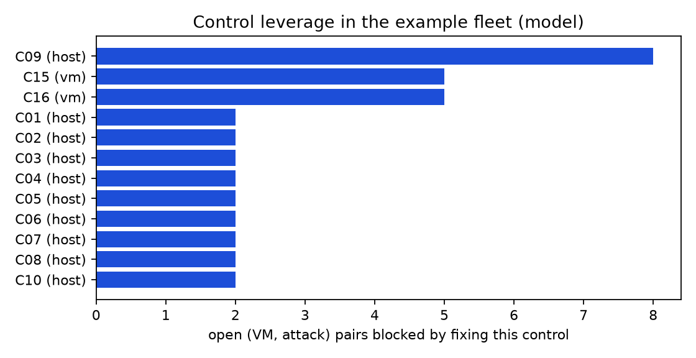
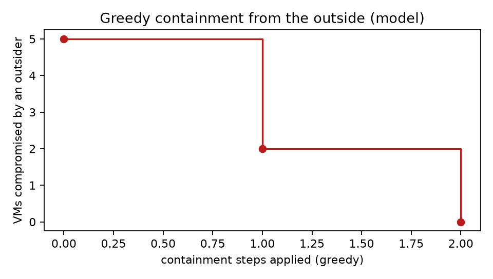
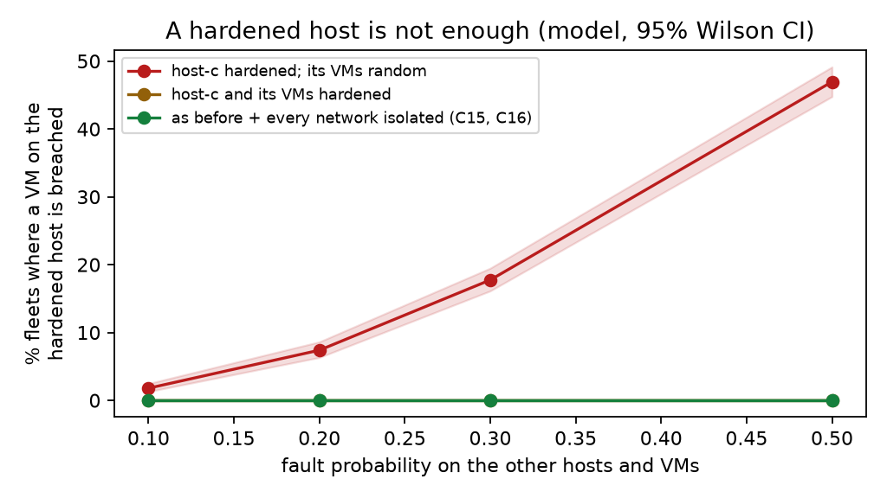

<!-- generated by scripts/run_experiments.py; do not edit by hand -->
Seed 20261109; 2026-11-10. All six experiments run on this repository without KVM hardware. E1 to E3 use constructed inputs with known ground truth; E4 to E6 evaluate the Attack Lab model. None of them is a measurement of a real host.

**E1. Single-fault injection (M1).** Each of the 26 testable configuration controls was broken in each of its seeded variants, one at a time, in an otherwise hardened folder (78 cases; C23 and C24 are NA by design because the shipped CVE list is unverified). The hardened baseline audits all-PASS: True. The seeded fault was reported as FAIL in 78/78 cases (95% Wilson CI [95.3, 100.0]), and in 78/78 cases no other control changed state ([95.3, 100.0]).

**E2. Multi-fault injection (M1).** 400 random folders, each control broken independently with probability p in {0.1, 0.3, 0.5, 0.7} (faults that write the same setting are not combined). Every testable control in every folder is one decision.

| Metric | Value | 95% CI |
|---|---|---|
| Decisions | 10400 | |
| Precision | 100.0% | [99.9, 100.0] |
| Recall | 100.0% | [99.9, 100.0] |
| F1 | 100.0% | |
| False-positive rate | 0.0% | |
| Audit time per folder (median / p95) | 40.3 ms / 72.8 ms | n = 400 |

| Fault probability p | Folders | Folders with every control correct | 95% CI |
|---|---|---|---|
| 0.1 | 100 | 100 | [96.3, 100.0] |
| 0.3 | 100 | 100 | [96.3, 100.0] |
| 0.5 | 100 | 100 | [96.3, 100.0] |
| 0.7 | 100 | 100 | [96.3, 100.0] |

Controls with any error: none.

**E3. Snapshot secret scanner (M2) on synthetic dumps.** 260 dumps of 256 KiB (65 MiB in total) with secrets planted by the generator, plus negative dumps.

| Group | Detected / present | Recall | 95% CI |
|---|---|---|---|
| plain | 120 / 120 | 100.0% | [96.9, 100.0] |
| held out | 0 / 120 | 0.0% | [0.0, 3.1] |

| Cell | Detected / present | Recall |
|---|---|---|
| aws/exited | 10 / 10 | 100.0% |
| aws/freed | 10 / 10 | 100.0% |
| aws/live | 10 / 10 | 100.0% |
| aws/live/base64 | 0 / 10 | 0.0% |
| aws/live/split | 0 / 10 | 0.0% |
| aws/live/utf16 | 0 / 10 | 0.0% |
| hex32/exited | 10 / 10 | 100.0% |
| hex32/freed | 10 / 10 | 100.0% |
| hex32/live | 10 / 10 | 100.0% |
| hex32/live/base64 | 0 / 10 | 0.0% |
| hex32/live/split | 0 / 10 | 0.0% |
| hex32/live/utf16 | 0 / 10 | 0.0% |
| jwt/exited | 10 / 10 | 100.0% |
| jwt/freed | 10 / 10 | 100.0% |
| jwt/live | 10 / 10 | 100.0% |
| jwt/live/base64 | 0 / 10 | 0.0% |
| jwt/live/split | 0 / 10 | 0.0% |
| jwt/live/utf16 | 0 / 10 | 0.0% |
| ssh_key/exited | 10 / 10 | 100.0% |
| ssh_key/freed | 10 / 10 | 100.0% |
| ssh_key/live | 10 / 10 | 100.0% |
| ssh_key/live/base64 | 0 / 10 | 0.0% |
| ssh_key/live/split | 0 / 10 | 0.0% |
| ssh_key/live/utf16 | 0 / 10 | 0.0% |

False positives: 0 (0.0 per GiB). Scan throughput 23.5 MiB/s on this laptop. After redaction, 240/240 planted dumps rescanned with zero hits; redaction adds 0 bytes.

**E3b. Scanner v2: fixing the gap.** After E3, we added two decoding passes (UTF-16LE text and base64 runs are decoded and the same rules run on the result; hits are reported as the encoded byte span). v2 is scored on freshly generated dumps (seed + 1), not on the dumps that revealed the gap.

| Group | v1 detected / present | v2 detected / present | v2 recall | v2 95% CI |
|---|---|---|---|---|
| plain | 120 / 120 | 120 / 120 | 100.0% | [96.9, 100.0] |
| held out | 0 / 120 | 80 / 120 | 66.7% | [57.8, 74.5] |

| Encoding | v1 | v2 |
|---|---|---|
| utf16 | 0 / 40 | 40 / 40 |
| base64 | 0 / 40 | 40 / 40 |
| split | 0 / 40 | 0 / 40 |

v2 false positives: 0 (0.0 per GiB); throughput 8.8 MiB/s; after v2 redaction 240/240 dumps rescan clean. Secrets split across pages remain undetected: a pattern needs the whole secret in one place.

**E4. Attack Lab: control leverage and containment (model, example fleet).** 27 of 66 (VM, attack) pairs are open. Fixing a single control everywhere it fails blocks this many open pairs:

| Rank | Control | Level | Open pairs blocked |
|---|---|---|---|
| 1 | C09 ksm off | host | 8 |
| 2 | C15 network mode | vm | 5 |
| 3 | C16 guest reachability | vm | 5 |
| 4 | C01 iommu cmdline | host | 2 |
| 5 | C02 iommu groups | host | 2 |
| 6 | C03 qemu seccomp config | host | 2 |
| 7 | C04 qemu seccomp live | host | 2 |
| 8 | C05 svirt config | host | 2 |
| 9 | C06 svirt live | host | 2 |
| 10 | C07 qemu not root | host | 2 |

Outsider campaign, VMs compromised after each greedy containment step: 5 -> 2 -> 0 (2 steps).

| VM | Risk score | Open attacks | Smallest fix set that blocks every modelled attack |
|---|---|---|---|
| web-frontend | 58 | 7 of 11 | 6 |
| ci-runner | 50 | 6 of 11 | 5 |
| dev-sandbox | 64 | 7 of 11 | 6 |
| legacy-erp | 56 | 6 of 11 | 5 |
| payments-db | 8 | 1 of 11 | 1 |
| monitoring | 0 | 0 of 11 | 0 |

**E5. Is a hardened host enough? (model, Monte Carlo).** 2000 random fleets per cell on the example topology. `kvm-host-c` is fully hardened; every other host and VM control fails independently with probability p. Cell = share of fleets in which an outsider compromises at least one VM on the hardened host (95% Wilson CI), and the mean number of VMs compromised in the fleet.

| p | host-c hardened; its VMs random | host-c and its VMs hardened | as before + every network isolated (C15, C16) |
|---|---|---|---|
| 0.1 | 1.8% [1.3, 2.5], mean 0.48 VMs | 0.0% [0.0, 0.2], mean 0.47 VMs | 0.0% [0.0, 0.2], mean 0.44 VMs |
| 0.2 | 7.4% [6.3, 8.6], mean 1.05 VMs | 0.0% [0.0, 0.2], mean 0.92 VMs | 0.0% [0.0, 0.2], mean 0.93 VMs |
| 0.3 | 17.8% [16.1, 19.5], mean 1.67 VMs | 0.0% [0.0, 0.2], mean 1.47 VMs | 0.0% [0.0, 0.2], mean 1.49 VMs |
| 0.5 | 46.9% [44.8, 49.1], mean 3.15 VMs | 0.0% [0.0, 0.2], mean 2.54 VMs | 0.0% [0.0, 0.2], mean 2.62 VMs |

**E6. Defence in depth (model).** Over random VM states (p = 0.3), 15983 of 27901 blocked (VM, attack) pairs (57.3%, CI [56.7, 57.9]) are held by exactly one control: one more misconfiguration would open them.

